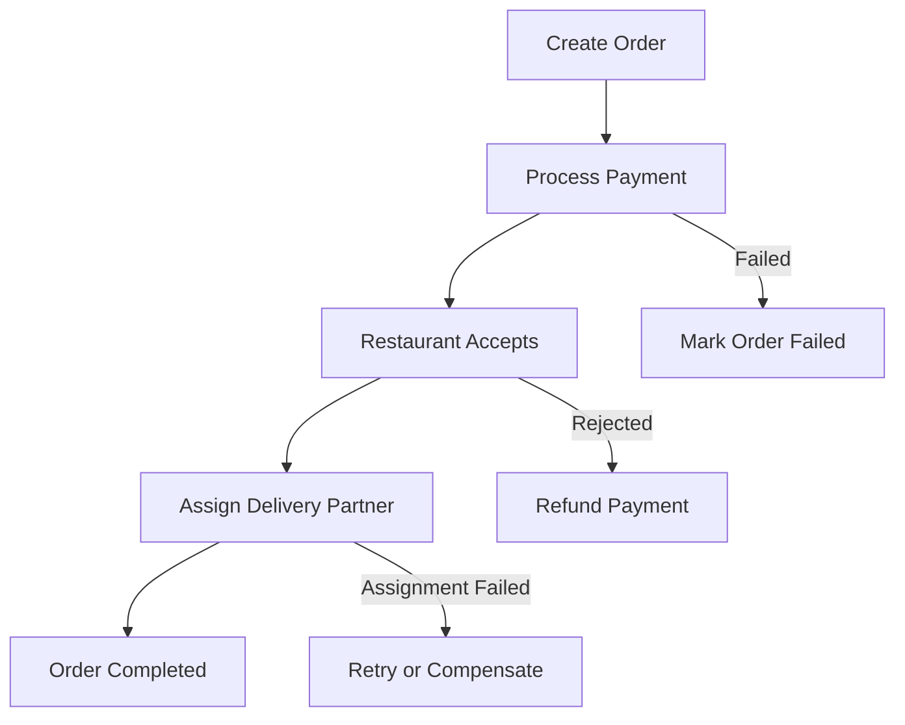

# Week 6 – Day 40: Food Delivery Application System Design

Day 40 of 49 Senior Android Developer Interview Preparation

Today we will design a complete Food Delivery Application like Swiggy, Zomato, or Uber Eats, starting from the basics and gradually moving toward senior-level system design.

Food Delivery App. Restaurants by Eugene Olefir for Fireart Studio on Dribbble

Food Delivery Live Tracking Screen | 黑哥 AI

ウーバーイーツの使い方 登録・注文方法から受け取りまで全解説 | アプリオ

## 1. Learning objectives

By the end of this lesson, you should be able to:

- Design a scalable food delivery application.
- Understand customer, restaurant, delivery partner and admin workflows.
- Design APIs and database schemas.
- Handle real-time order tracking.
- Understand restaurant discovery and location-based search.
- Design order lifecycle and state management.
- Handle payments, failures and retries.
- Understand scalability, caching and distributed systems.
- Explain Android application architecture for a food delivery app.
- Answer senior-level system design interview questions.

## 2. Understand the problem

Imagine building an application similar to Swiggy or Zomato.

There are four primary actors.

Order food online

1. Customer

- Browse restaurants.
- View menus.
- Add food to cart.
- Place orders.
- Make payments.
- Track deliveries.
- Rate restaurants.

Essential Licenses for Restaurant Success — Over Easy Office

2. Restaurant

- Manage menu.
- Update food availability.
- Accept or reject orders.
- Prepare food.
- Update preparation status.

Zomato: Marriott partners with Zomato for home delivery service - The Economic Times

3. Delivery Partner

- Go online/offline.
- Receive delivery requests.
- Accept delivery assignments.
- Pick up food.
- Deliver orders.
- Share live location.

Best Web Development & Software Company in Hajipur, Bihar & Patna | DH Technology

4. Admin

- Manage users.
- Manage restaurants.
- Monitor orders.
- Handle disputes.
- Monitor delivery partners.

## 3. Functional requirements

Functional requirements describe what our system should do.

| Feature | Description |
| --- | --- |
| User authentication | Login, signup, logout |
| Location management | Detect and save delivery addresses |
| Restaurant discovery | Find nearby restaurants |
| Menu management | Display available food items |
| Cart | Add, update and remove items |
| Order placement | Create and confirm orders |
| Payment | UPI, cards, wallets, COD |
| Restaurant management | Accept and prepare orders |
| Delivery assignment | Assign delivery partners |
| Live tracking | Track delivery partner location |
| Notifications | Order and delivery updates |
| Ratings | Rate restaurants and delivery partners |

## 4. Non-functional requirements

These are particularly important for senior-level interviews.

| Requirement | Explanation |
| --- | --- |
| Scalability | Support millions of customers |
| Availability | Application should remain operational |
| Low latency | Restaurant search should be fast |
| Consistency | Orders and payments must be accurate |
| Reliability | Orders should not disappear |
| Security | Protect customer and payment data |
| Fault tolerance | Handle service failures |
| Real-time updates | Track orders with minimal delay |

Important interview point: An incorrect restaurant image is inconvenient. An incorrect payment or duplicate order is much more serious. Therefore, different parts of the system need different consistency guarantees.

## 5. High-level architecture (HLD)

Let's first understand the overall architecture.

[tryexponent.com](<https://www.tryexponent.com/courses/system-design-interviews/design-uber-eats?utm_source=chatgpt.com>)

Our architecture contains the following components:

| Component | Responsibility |
| --- | --- |
| Android App | Customer-facing application |
| Restaurant App | Restaurant order management |
| Delivery App | Delivery partner application |
| API Gateway | Routes client requests |
| Auth Service | Authentication and authorization |
| User Service | User profiles and addresses |
| Restaurant Service | Restaurant information |
| Search Service | Restaurant and menu search |
| Cart Service | Shopping cart management |
| Order Service | Order lifecycle |
| Payment Service | Payment processing |
| Delivery Service | Delivery partner assignment |
| Location Service | Live location tracking |
| Notification Service | Push notifications |
| Message Queue | Asynchronous communication |
| Database | Persistent storage |
| Redis | Caching and temporary data |

### How components communicate

There are two important communication types:

1. Synchronous communication

The client sends a request and waits for a response.

Example:

- Fetch restaurant details.
- Fetch menu.
- Add an item to cart.
- Get order details.

2. Asynchronous communication

The service publishes an event, and another service processes it independently.

Example:

- Order placed.
- Restaurant notified.
- Delivery assignment initiated.
- Customer receives notification.

This reduces tight coupling between services.

## 6. Complete order lifecycle

This is one of the most important parts of today's interview.

배민외식업광장

[ceo.baemin.com](<https://ceo.baemin.com/guide/10593?utm_source=chatgpt.com>)

Let's understand the order lifecycle.

| Status | Meaning |
| --- | --- |
| CREATED | Order created |
| PAYMENT\_PENDING | Payment processing |
| CONFIRMED | Payment and order confirmation completed |
| RESTAURANT\_ACCEPTED | Restaurant accepted |
| PREPARING | Food preparation started |
| READY\_FOR\_PICKUP | Food ready |
| DELIVERY\_ASSIGNED | Delivery partner assigned |
| PICKED\_UP | Delivery partner collected food |
| OUT\_FOR\_DELIVERY | Order on its way |
| DELIVERED | Successfully delivered |
| CANCELLED | Order cancelled |
| FAILED | Order failed |

Important: Never allow arbitrary order status changes. Use a controlled state machine with validated transitions.

For example:

- CREATED → PAYMENT\_PENDING
- PAYMENT\_PENDING → CONFIRMED
- CONFIRMED → RESTAURANT\_ACCEPTED
- RESTAURANT\_ACCEPTED → PREPARING
- PREPARING → READY\_FOR\_PICKUP
- READY\_FOR\_PICKUP → PICKED\_UP
- PICKED\_UP → DELIVERED

Cancellation and failure transitions should have their own rules.

## 7. Database design

Let's identify our major database tables.

### Users

| Column | Type |
| --- | --- |
| user\_id | UUID |
| name | VARCHAR |
| email | VARCHAR |
| phone | VARCHAR |
| created\_at | TIMESTAMP |

### Restaurants

| Column | Type |
| --- | --- |
| restaurant\_id | UUID |
| name | VARCHAR |
| latitude | DECIMAL |
| longitude | DECIMAL |
| address | TEXT |
| is\_open | BOOLEAN |

### Menu Items

| Column | Type |
| --- | --- |
| item\_id | UUID |
| restaurant\_id | UUID |
| name | VARCHAR |
| price | DECIMAL |
| is\_available | BOOLEAN |

### Orders

| Column | Type |
| --- | --- |
| order\_id | UUID |
| user\_id | UUID |
| restaurant\_id | UUID |
| total\_amount | DECIMAL |
| order\_status | VARCHAR |
| payment\_status | VARCHAR |
| created\_at | TIMESTAMP |

### Order Items

| Column | Type |
| --- | --- |
| order\_item\_id | UUID |
| order\_id | UUID |
| item\_id | UUID |
| quantity | INT |
| item\_price | DECIMAL |

### Delivery Partners

| Column | Type |
| --- | --- |
| partner\_id | UUID |
| name | VARCHAR |
| availability\_status | VARCHAR |
| latitude | DECIMAL |
| longitude | DECIMAL |

### Payments

| Column | Type |
| --- | --- |
| payment\_id | UUID |
| order\_id | UUID |
| amount | DECIMAL |
| payment\_status | VARCHAR |
| transaction\_reference | VARCHAR |

Interview tip: Store the item name and price as a snapshot in Order Items. If a restaurant changes its menu price tomorrow, historical orders must still show the original purchased price.

## 8. API design

Let's design some important REST APIs.

| Method | Endpoint | Purpose |
| --- | --- | --- |
| POST | `/api/v1/auth/login` | User login |
| GET | `/api/v1/restaurants` | Nearby restaurants |
| GET | `/api/v1/restaurants/{id}` | Restaurant details |
| GET | `/api/v1/restaurants/{id}/menu` | Restaurant menu |
| POST | `/api/v1/cart/items` | Add item to cart |
| GET | `/api/v1/cart` | Get cart |
| POST | `/api/v1/orders` | Place order |
| GET | `/api/v1/orders/{id}` | Get order details |
| POST | `/api/v1/payments` | Initiate payment |
| GET | `/api/v1/orders/{id}/tracking` | Track delivery |

Example: Place an order.

http

```http
POST /api/v1/orders
Authorization: Bearer <access_token>
Idempotency-Key: unique-request-key
Content-Type: application/json
```

Request:

json

```json
{
  "restaurant_id": "restaurant_123",
  "items": [
    {
      "item_id": "item_101",
      "quantity": 2
    },
    {
      "item_id": "item_102",
      "quantity": 1
    }
  ],
  "delivery_address_id": "address_456",
  "payment_method": "UPI"
}
```

Response:

json

```json
{
  "order_id": "order_789",
  "status": "PAYMENT_PENDING",
  "total_amount": 450,
  "currency": "INR"
}
```

The server must calculate the actual price. Never trust the total amount sent by the Android application.

## 9. Restaurant discovery and location-based search

Suppose a customer opens the application.

We need to find restaurants within a particular delivery radius.

Example:

- Customer location: Hyderabad.
- Search radius: 5 km.
- Restaurant A: 1 km.
- Restaurant B: 3 km.
- Restaurant C: 8 km.

Restaurant C should not appear in the initial 5 km result set.

We can use:

- Geospatial indexing.
- Geohashing.
- Redis GEO.
- PostGIS.
- Location-based filtering.

Geospatial Queries - R and MongoDB | Symbolix - Making your data work harder

[symbolix.com.au](<https://www.symbolix.com.au/blog-main/2017-3?utm_source=chatgpt.com>)

Interview question: Why not simply calculate the distance between every restaurant and the customer?

Because scanning every restaurant becomes expensive at scale. Geospatial indexes help narrow down candidates efficiently before calculating precise distances.

## 10. Real-time delivery tracking

This is another very important senior-level topic.

Imagine a delivery partner moving toward a customer.

How does the customer see the live location?

Foodx- Food Ordering Muti Restaurant Platform | Customer App with Admin Panel by arcadexit

[codecanyon.net](<https://codecanyon.net/item/foodx-multi-restaurant-food-delivery-app-with-admin/61272196?utm_source=chatgpt.com>)

### Architecture

1. Delivery partner Android app collects GPS coordinates.
2. Delivery app sends location updates to Location Service.
3. Location Service validates and processes updates.
4. Latest location is stored in Redis.
5. Location events are published to a message broker.
6. Tracking service sends updates to the customer using WebSockets.
7. Customer Android app updates the map marker.

Example location payload:

json

```json
{
  "partner_id": "partner_123",
  "order_id": "order_789",
  "latitude": 17.385,
  "longitude": 78.486,
  "timestamp": "2026-10-31T12:00:00Z"
}
```

### Why WebSockets?

HTTP polling requires repeated requests.

WebSockets maintain a persistent, bidirectional connection.

| Polling | WebSockets |
| --- | --- |
| Repeated HTTP requests | Persistent connection |
| Higher request overhead | Lower messaging overhead |
| Updates at polling intervals | Server can push updates |
| Simple implementation | More connection management |

WebSockets are useful for live tracking, but push notifications are useful when the application is in the background or disconnected.

## 11. Payment architecture

Payments require special attention.

Consider this scenario:

1. Customer places an order.
2. Payment gateway processes payment.
3. Payment succeeds.
4. Network connection fails before the Android app receives the response.
5. Customer clicks Pay again.

What happens?

We must prevent duplicate payments.

Solutions:

- Idempotency keys.
- Payment transaction IDs.
- Server-side payment verification.
- Gateway webhooks.
- Payment status reconciliation.

Important: The Android app must never be the source of truth for payment success. Verify the transaction with the payment provider on the backend.

## 12. Handling failure scenarios

Senior interviews often focus on failure handling rather than just happy paths.

| Scenario | Solution |
| --- | --- |
| Restaurant rejects order | Cancel or reassign according to business rules; initiate refund if applicable |
| Payment succeeds but order creation fails | Reconcile payment and order state |
| Delivery partner disconnects | Reconnection and assignment recovery |
| Duplicate order request | Idempotency key |
| Notification fails | Retry through message queue |
| Location updates stop | Show last known location and timestamp |
| Restaurant service goes down | Circuit breaker and fallback |
| Database temporarily unavailable | Retry with backoff where safe |

### Important distributed systems concept: Saga Pattern

Consider an order involving multiple services:

- Order Service
- Payment Service
- Restaurant Service
- Delivery Service

A single database transaction cannot normally cover all these independent services.

We can use the Saga Pattern.

Example:

mermaid



A Saga uses compensating actions to recover from failures across multiple services.

## 13. Android application architecture

Now let's connect this system design to your Senior Android Developer interview.

We can use Clean Architecture with MVVM.

Implementing ExoPlayer Using Android Media3 — Part II | by Anand Jeyapal | Medium

[medium.com](<https://medium.com/%40janand1991/implementing-exoplayer-using-android-media3-part-ii-f83c7aa430b4?utm_source=chatgpt.com>)

Suggested structure:

text

```text
FoodDeliveryApp/
│
├── presentation/
│   ├── home/
│   ├── restaurant/
│   ├── cart/
│   ├── checkout/
│   ├── orders/
│   └── tracking/
│
├── domain/
│   ├── model/
│   ├── repository/
│   └── usecase/
│
├── data/
│   ├── remote/
│   ├── local/
│   ├── repository/
│   └── mapper/
│
└── core/
    ├── network/
    ├── database/
    ├── di/
    └── common/
```

### Android technologies

| Requirement | Technology |
| --- | --- |
| UI | Jetpack Compose |
| Architecture | MVVM + Clean Architecture |
| Dependency Injection | Hilt |
| Networking | Retrofit + OkHttp |
| Asynchronous operations | Coroutines |
| Reactive streams | StateFlow |
| Local database | Room |
| Background work | WorkManager |
| Image loading | Coil |
| Maps | Google Maps SDK |
| Push notifications | Firebase Cloud Messaging |
| Real-time tracking | WebSocket client |

### Example: Tracking screen ViewModel

kotlin

```kotlin
data class DeliveryLocation(
    val latitude: Double,
    val longitude: Double
)

class TrackingViewModel(
    private val repository: TrackingRepository
) : ViewModel() {

    val location: StateFlow<DeliveryLocation?> =
        repository.observeDeliveryLocation()
            .stateIn(
                scope = viewModelScope,
                started = SharingStarted.WhileSubscribed(5000),
                initialValue = null
            )
}
```

The repository can manage WebSocket connections and expose location updates through a Flow.

In production, also handle reconnection, stale location updates, lifecycle changes and background execution restrictions.

## 14. Scalability considerations

How do we support millions of customers?

| Problem | Solution |
| --- | --- |
| Too many restaurant requests | Redis caching |
| Large restaurant database | Database indexing and sharding when needed |
| High image traffic | CDN |
| Too many location updates | Throttling and location update batching |
| High order volume | Horizontal service scaling |
| Notification traffic | Message queues |
| Database read load | Read replicas |
| Service failures | Circuit breakers |
| Heavy search traffic | Dedicated search infrastructure |

## 15. Senior-level interview questions

Try to answer these without looking at the explanations.

Interview practice

0/8 revealed

1. How would you prevent duplicate food orders?

Reveal answer

2. How would you handle payment success but order creation failure?

Reveal answer

3. How would you find nearby restaurants efficiently?

Reveal answer

4. Why use Redis for delivery tracking?

Reveal answer

5. How would you handle delivery partner disconnection?

Reveal answer

6. Why use Saga instead of a distributed database transaction?

Reveal answer

7. How would you design an offline-friendly Android cart?

Reveal answer

8. How would you prevent a restaurant from receiving an order for unavailable food?

Reveal answer

## 16. Practical system design exercise

Try designing the following yourself:

Design a food delivery application supporting:

- 10 million registered customers.
- 100,000 restaurants.
- 50,000 active delivery partners.
- 1 million orders per day.

Your design should include:

1. High-level architecture.
2. Functional and non-functional requirements.
3. Database schema.
4. REST API design.
5. Order lifecycle.
6. Payment architecture.
7. Real-time tracking.
8. Caching strategy.
9. Failure handling.
10. Android architecture.

These numbers are hypothetical interview assumptions, not production benchmarks.

## 17. Day 40 revision checklist

Learning progress

# 0%

[ ]Understand all four actors and their responsibilities

[ ]Understand functional and non-functional requirements

[ ]Draw the high-level architecture

[ ]Understand order lifecycle and state transitions

[ ]Design database tables and relationships

[ ]Design REST APIs

[ ]Understand geospatial restaurant discovery

[ ]Understand WebSocket-based tracking

[ ]Understand payment idempotency

[ ]Understand Saga Pattern

[ ]Understand Android Clean Architecture

[ ]Understand scalability and failure handling

[ ]Practice all eight senior-level interview questions

0 of 13 topics completed

 Reset checklist

## 18. Final interview takeaway

For a Senior Android Developer with 7 years of experience, don't stop at designing backend services.

You should be able to explain:

- How the Android app communicates with backend services.
- How to handle network failures and retries.
- How to persist cart and order information locally.
- How to manage WebSocket connections.
- How to implement live tracking efficiently.
- How to handle app backgrounding and process death.
- How to maintain consistency between local and remote state.
- How to optimize battery, memory and network usage.

Day 40 lesson completeNext lesson – Week 6, Day 41: E-commerce Application System Design

We will design a complete Amazon/Flipkart-like system, including product catalog, search, cart, inventory management, orders, payments, distributed transactions and scalability.
