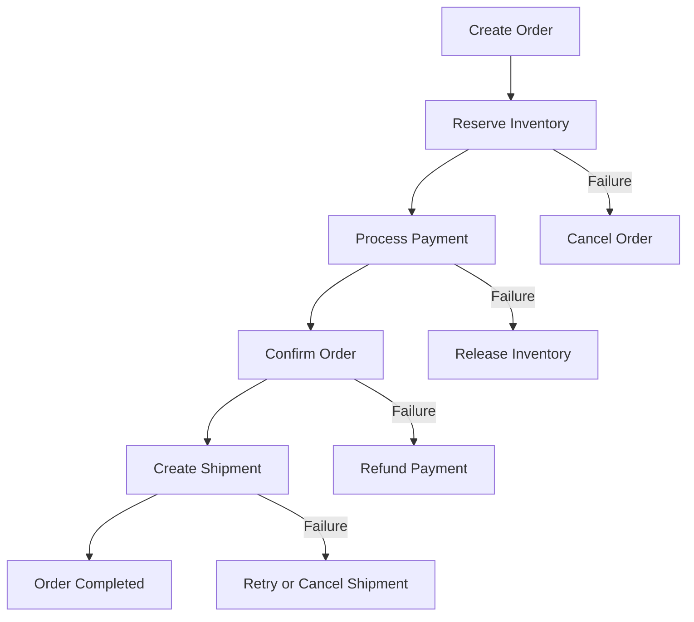
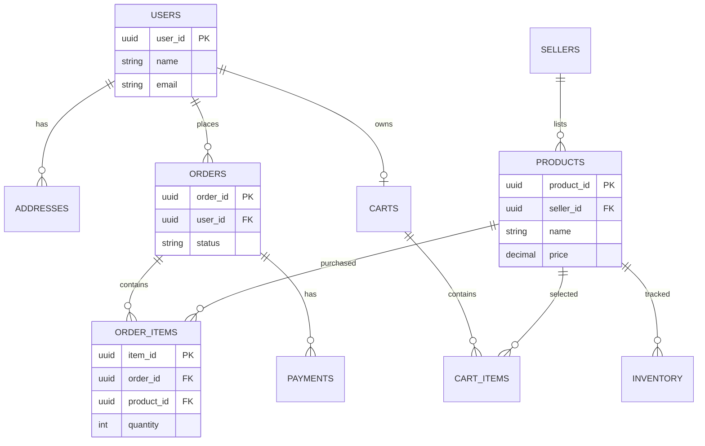

# Week 6 – Day 41: E-commerce Application System Design

Day 41 of 49 Senior Android Developer Preparation

Markdown notes: `41-E-commerce-Application-System-Design.md`

Today we will design a large-scale e-commerce application similar to Amazon or Flipkart.

The goal is to understand the complete system, from a customer opening the Android application to searching for products, adding items to the cart, placing orders, completing payments and receiving deliveries.

These notes start with beginner-friendly explanations and gradually cover advanced system design concepts expected in Senior Android Developer interviews.

E-commerce App Design by Sheikh Raihan on Dribbble

E Commerce App UI DESIGN for Shopping Cart and Payment by Muhammad Bilal on Dribbble

Package Delivery App by Victoria Gapanovich on Dribbble

## 1. What are we building?

Imagine we want to build an e-commerce platform where millions of customers can purchase products online.

A customer should be able to:

1. Open the application.
2. Search for a product.
3. View product details.
4. Check product availability.
5. Add products to the cart.
6. Apply coupons and discounts.
7. Place an order.
8. Make a payment.
9. Track the order.
10. Cancel or return a product.

Behind the scenes, several services work together to make this possible.

For example, when a customer buys a mobile phone:

- Product Service provides product information.
- Search Service helps discover the mobile phone.
- Inventory Service checks stock availability.
- Cart Service manages selected items.
- Pricing Service calculates the final price.
- Order Service creates the order.
- Payment Service processes payment.
- Notification Service sends order updates.
- Delivery Service manages shipment tracking.

This is why e-commerce application design is an excellent system design interview problem.

## 2. Understand the major actors

An e-commerce platform has several different users.

woman shopping online with her smartphone on the living room sofa

1. Customer

- Search products.
- Browse categories.
- Add products to cart.
- Purchase products.
- Track orders.
- Request returns and refunds.

Switch 3PL Without Disruption | Fulfilment Switching Programme | Rapid Pack

2. Seller

- Register products.
- Update product information.
- Manage pricing.
- Manage inventory.
- Process orders.

X1 – Delivering Optimum Return on your Direct Marketing and Print Investment

3. Warehouse / Fulfillment Team

- Store products.
- Pick products.
- Pack orders.
- Update shipment status.

Vietnam’s e-commerce market records strong growth in first half of 2026 - VnEconomy

4. Delivery Partner

- Collect packages.
- Update shipment status.
- Deliver packages.
- Report delivery failures.

Home - BeePlace

5. Admin

- Manage customers and sellers.
- Monitor products.
- Manage orders.
- Handle disputes.
- Monitor business operations.

## 3. Functional requirements

Functional requirements describe what our application must do.

| Feature | Explanation |
| --- | --- |
| Authentication | Login, signup and logout |
| User profile | Manage customer information |
| Product catalog | Display products |
| Product search | Search products by name and category |
| Product details | Display descriptions, prices and images |
| Product filtering | Filter by price, brand and rating |
| Cart | Add, update and remove products |
| Wishlist | Save products for later |
| Coupons | Apply discounts |
| Checkout | Confirm delivery address and order |
| Payments | UPI, cards, wallets and COD |
| Inventory | Track product availability |
| Order management | Create and manage orders |
| Shipment tracking | Track delivery |
| Returns | Return and refund products |
| Notifications | Send order and payment updates |

## 4. Non-functional requirements

These are equally important in senior-level interviews.

| Requirement | Explanation |
| --- | --- |
| Scalability | Support millions of users |
| Availability | Keep the application operational |
| Low latency | Load products quickly |
| Consistency | Maintain accurate inventory and payments |
| Reliability | Avoid losing orders |
| Security | Protect user and payment information |
| Fault tolerance | Recover from service failures |
| Durability | Persist confirmed orders |
| Maintainability | Allow services to evolve independently |

### Important concept: Strong consistency vs eventual consistency

Not every feature requires the same consistency guarantee.

Strong consistency

When a customer purchases the last available product, the inventory system must prevent another customer from purchasing the same unit.

Eventual consistency

Product ratings, view counts and some search index updates can be slightly delayed.

For example, when a seller changes a product description, the search index might take a short time to reflect that change.

This distinction is important when designing scalable systems.

## 5. High-level system architecture

Let's design the overall architecture.

Designing an E-commerce Platform in 45 Minutes: A Complete System Design Interview Guide

[designgurus.substack.com](<https://designgurus.substack.com/p/designing-an-e-commerce-platform?utm_source=chatgpt.com>)

### Architecture components

| Component | Responsibility |
| --- | --- |
| Android App | Customer interface |
| Seller App | Seller management |
| Admin Dashboard | Platform administration |
| API Gateway | Routes client requests |
| Auth Service | Authentication |
| User Service | User profiles |
| Product Service | Product information |
| Search Service | Product discovery |
| Pricing Service | Prices and discounts |
| Cart Service | Shopping cart |
| Inventory Service | Stock management |
| Order Service | Order lifecycle |
| Payment Service | Payment processing |
| Shipping Service | Delivery management |
| Review Service | Ratings and reviews |
| Notification Service | Push notifications |
| Redis | Frequently accessed data |
| Message Broker | Asynchronous events |
| Databases | Persistent information |
| CDN | Product images and static content |

### Why divide the system into services?

Imagine one application handles everything:

- Login.
- Product search.
- Cart.
- Payments.
- Orders.
- Inventory.
- Notifications.

As the application grows, this monolithic application becomes difficult to maintain and scale independently.

For example, during a major sale, product search might receive millions of requests.

We should be able to scale the Search Service without unnecessarily scaling the Payment Service.

This is one reason to consider microservices.

However, microservices introduce network failures, data consistency challenges and operational complexity. A modular monolith can be a better starting point for smaller systems.

## 6. Product catalog design

The Product Catalog is responsible for managing product information.

For example:

Gadget - Electronic Ecommerce Mobile App Design by RL studio on Dribbble

[dribbble.com](<https://dribbble.com/shots/27319555-Gadget-Electronic-Ecommerce-Mobile-App-Design?utm_source=chatgpt.com>)

A product may contain:

- Product ID.
- Product name.
- Description.
- Brand.
- Category.
- Price.
- Images.
- Specifications.
- Rating.
- Seller ID.
- Availability.

### Product database

| Column | Type | Description |
| --- | --- | --- |
| product\_id | UUID | Unique product ID |
| name | VARCHAR | Product name |
| description | TEXT | Product details |
| brand\_id | UUID | Brand reference |
| category\_id | UUID | Category reference |
| price | DECIMAL | Current displayed price |
| status | VARCHAR | Active/inactive |
| created\_at | TIMESTAMP | Creation time |

### Product images

Should we store product images directly inside the database?

Generally, no.

Instead:

1. Upload images to object storage.
2. Generate image URLs.
3. Store image metadata and URLs in the database.
4. Serve images through a CDN.
5. Android application downloads images from the CDN.

Using Object Storage With Akamai CDN | Linode Docs

[akamai.com](<https://www.akamai.com/cloud/guides/using-object-storage-with-akamai-cdn?utm_source=chatgpt.com>)

Why?

- Databases are not ideal for serving large image files.
- Object storage handles large files efficiently.
- CDN reduces latency.
- Images can be cached closer to users.

## 7. Product search architecture

Imagine a customer searches for:

`Samsung Galaxy S series`

How should we find relevant products?

A simple SQL query may work for a small application:

sql

```sql
SELECT *
FROM products
WHERE name LIKE '%Samsung Galaxy S%';
```

But large-scale search requires more advanced capabilities.

Examples:

- Full-text search.
- Typo tolerance.
- Autocomplete.
- Filters.
- Sorting.
- Ranking.
- Category search.

We can use a search engine such as Elasticsearch or OpenSearch.

Search at Scale: How E-Commerce Platforms Deliver Results in Milliseconds | by Nishant Kumar | Medium

[medium.com](<https://medium.com/%40nishantkumar.jss/search-at-scale-how-e-commerce-platforms-deliver-results-in-milliseconds-a5130a44debe?utm_source=chatgpt.com>)

### How search works

1. Seller creates or updates a product.
2. Product Service saves information in the primary database.
3. An event is published.
4. Search Indexing Service consumes the event.
5. Search engine updates its index.
6. Customer searches for a product.
7. Search Service queries the search engine.
8. Matching products are returned.

### Why not query the main database for every search?

Search engines provide features optimized for:

- Text matching.
- Relevance scoring.
- Autocomplete.
- Filtering.
- Sorting.

The search index is usually a derived representation of the primary product data, not the authoritative source.

Interview point: Search indexing is often eventually consistent. A newly created product may not appear immediately in search results.

## 8. Shopping cart design

The cart is one of the most important features.

Imagine a customer adds:

- One mobile phone.
- Two headphones.
- One laptop.

The cart must maintain the selected items and their quantities.

E-Commerce Mobile App Design | Online Store App UI :: Behance

[behance.net](<https://www.behance.net/gallery/158923653/E-Commerce-Mobile-App-Design-Online-Store-App-UI?utm_source=chatgpt.com>)

### Cart database

Cart table

| Column | Type |
| --- | --- |
| cart\_id | UUID |
| user\_id | UUID |
| updated\_at | TIMESTAMP |

Cart Items table

| Column | Type |
| --- | --- |
| cart\_item\_id | UUID |
| cart\_id | UUID |
| product\_id | UUID |
| quantity | INT |
| added\_at | TIMESTAMP |

### Where should we store cart data?

Two common approaches:

Option 1: Redis

Useful for fast access and temporary cart state.

Option 2: Persistent database

Useful when cart information must survive service restarts and remain available across devices.

A production architecture may combine both.

### Important cart consistency problem

Imagine:

1. Customer adds a product to the cart.
2. Product price is ₹10,000.
3. Seller changes the price to ₹12,000.
4. Customer opens checkout.

Should we charge ₹10,000?

Not automatically.

The backend must revalidate:

- Current product price.
- Product availability.
- Quantity limits.
- Seller status.
- Applicable discounts.

The cart is not a guarantee that the product price or inventory will remain unchanged.

## 9. Inventory management

Very important interview topicInventory means the number of products available for sale.

Suppose a seller has 10 mobile phones.

Two customers simultaneously attempt to purchase the last available phone.

If both requests read the stock as 1 and both decrement it, the system might sell two phones when only one exists.

This is called an overselling problem.

### Incorrect implementation

sql

```sql
SELECT stock
FROM inventory
WHERE product_id = 'P101';
```

Then application code checks whether stock is greater than zero and updates it separately.

This creates a race condition.

### Safer atomic update

sql

```sql
UPDATE inventory
SET available_quantity = available_quantity - 1
WHERE product_id = 'P101'
AND available_quantity >= 1;
```

Check the affected row count:

- One row updated: stock was reserved successfully.
- Zero rows updated: insufficient stock.

The database executes this update atomically.

For multiple products, use an appropriate transaction or reservation workflow.

### Inventory reservation

A more advanced approach is to reserve stock temporarily during checkout.

Example:

1. Customer initiates checkout.
2. Inventory Service reserves one unit.
3. Reservation gets an expiration time.
4. Payment succeeds.
5. Reservation becomes a confirmed allocation.
6. If payment fails or times out, the reservation is released.

How to Make Your Apps Observable by Default | DBOS

[dbos.dev](<https://www.dbos.dev/blog/how-to-make-your-apps-observable-by-default?utm_source=chatgpt.com>)

This avoids holding stock indefinitely for customers who never complete payment.

## 10. Order management

Now let's understand the complete order lifecycle.

Free State Diagram Generator | State Transition Diagram Maker Online - Figviz

[figviz.com](<https://figviz.com/tools/state-diagram-generator?utm_source=chatgpt.com>)

### Order status

| Status | Meaning |
| --- | --- |
| CREATED | Order request created |
| INVENTORY\_RESERVED | Stock reserved |
| PAYMENT\_PENDING | Payment initiated |
| CONFIRMED | Order confirmed |
| PROCESSING | Seller processing order |
| PACKED | Product packed |
| SHIPPED | Handed to delivery |
| OUT\_FOR\_DELIVERY | Delivery in progress |
| DELIVERED | Successfully delivered |
| CANCELLED | Order cancelled |
| FAILED | Order failed |
| RETURN\_REQUESTED | Customer requested return |
| RETURNED | Product returned |
| REFUNDED | Payment refunded |

### Important distinction

Order status and payment status should be separate.

For example:

- Order status: `PAYMENT_PENDING`
- Payment status: `INITIATED`

Another example:

- Order status: `CONFIRMED`
- Payment status: `CAPTURED`

A payment failure should not be confused with an order cancellation. The system must handle both states independently.

### Order database

| Column | Type |
| --- | --- |
| order\_id | UUID |
| user\_id | UUID |
| total\_amount | DECIMAL |
| order\_status | VARCHAR |
| payment\_status | VARCHAR |
| shipping\_address\_id | UUID |
| created\_at | TIMESTAMP |

### Order Items database

| Column | Type |
| --- | --- |
| order\_item\_id | UUID |
| order\_id | UUID |
| product\_id | UUID |
| product\_name | VARCHAR |
| quantity | INT |
| unit\_price | DECIMAL |

Important: Store the product name and unit price as snapshots in the order items. A seller changing a product's name or price later must not alter historical order details.

## 11. Checkout and payment architecture

Checkout is where several services work together.

Example:

Customer wants to buy a mobile phone for ₹20,000.

Additional charges:

- Product price: ₹20,000
- Delivery charge: ₹50
- Discount: ₹1,000
- Final amount: ₹19,050

The backend should calculate the final amount.

The Android application must never be trusted as the authority for prices or discounts.

### Checkout flow

1. Customer selects delivery address.
2. Cart Service retrieves cart items.
3. Product Service validates product information.
4. Pricing Service calculates the amount.
5. Inventory Service reserves stock.
6. Order Service creates the order.
7. Payment Service initiates payment.
8. Payment provider processes the transaction.
9. Backend verifies the payment.
10. Order is confirmed.

Designing an E-Commerce System like Amazon That Actually Works | by Khushboo Kumari | Feb, 2026 | Medium

[medium.com](<https://medium.com/%40k.khusi431/designing-an-e-commerce-system-like-amazon-that-actually-works-7f72143fcbe2?utm_source=chatgpt.com>)

### Payment failure scenario

Consider this situation:

1. Customer clicks Pay.
2. Payment gateway successfully processes the payment.
3. Internet connection disconnects.
4. Android application does not receive the response.
5. Customer clicks Pay again.

This can cause duplicate payment attempts if the backend is not designed properly.

### Solutions

- Idempotency keys.
- Unique payment transaction IDs.
- Server-side verification.
- Payment gateway webhooks.
- Payment reconciliation.
- Retry with appropriate safeguards.

### What is idempotency?

Idempotency means repeating the same operation with the same idempotency key should not create duplicate effects.

Example:

http

```http
POST /api/v1/orders
Idempotency-Key: checkout-abc123
```

If the same request reaches the server multiple times, the backend should return the original result instead of creating multiple orders.

The key must be persisted and scoped appropriately, and the server must handle concurrent duplicate requests.

## 12. Distributed transactions and Saga Pattern

This is a particularly important senior-level concept.

Imagine order placement involves four independent services:

- Order Service.
- Inventory Service.
- Payment Service.
- Shipping Service.

What happens if payment succeeds but the shipping service fails?

We cannot simply roll back every database using one ordinary database transaction.

Instead, we can use the Saga Pattern.

### Saga workflow

mermaid



### What is a compensating transaction?

A compensating transaction reverses or counteracts a previously completed business operation.

Examples:

| Completed operation | Compensating action |
| --- | --- |
| Reserve inventory | Release inventory |
| Capture payment | Initiate refund |
| Create shipment | Cancel shipment if supported |
| Create order | Cancel order |

A refund is not necessarily an immediate reversal of a payment. It is a separate operation that may take time.

### Why Saga?

- Services maintain independent databases.
- No global database transaction is required.
- Failures can be recovered through compensating actions.
- The workflow can continue asynchronously.

## 13. Caching strategy

E-commerce platforms receive huge numbers of read requests.

For example:

A popular mobile phone may receive millions of product detail requests during a major sale.

We should not query the primary database for every request.

We can use Redis.

API Development Series Part 2: Data Layer & Persistence - Wasil Zafar

[wasilzafar.com](<https://www.wasilzafar.com/pages/series/api-development/api-dev-data-persistence.html?utm_source=chatgpt.com>)

### Cache-aside pattern

1. Customer requests product details.
2. Application checks Redis.
3. If data exists, return cached data.
4. If data does not exist, query the database.
5. Store the result in Redis.
6. Return the result.

Example:

text

```text
Request Product P101
        |
        v
    Check Redis
        |
   +----+----+
   |         |
 Cache Hit  Cache Miss
   |         |
   v         v
 Return    Query Database
 Data         |
              v
          Update Redis
              |
              v
          Return Data
```

### What should we cache?

| Data | Caching strategy |
| --- | --- |
| Product details | Cache-aside |
| Product categories | Longer TTL |
| Product images | CDN |
| Search results | Short-lived cache |
| User profile | Cache-aside |
| Cart | Redis with persistence strategy |
| Inventory | Carefully managed; never trust stale cache for final stock allocation |

Important: Cache is not the source of truth for critical inventory or payment decisions.

## 14. Message queues and event-driven architecture

Imagine a customer successfully places an order.

The system needs to:

- Notify the seller.
- Update analytics.
- Send a customer notification.
- Start shipment preparation.
- Update order history.

Should the Order Service make synchronous HTTP calls to all these services?

That can make order placement slow and tightly coupled.

Instead, publish an event.

Example:

json

```json
{
  "event_type": "ORDER_CONFIRMED",
  "order_id": "ORDER123",
  "user_id": "USER456",
  "timestamp": "2026-10-31T12:00:00Z"
}
```

Other services consume the event independently.

Event-Driven Microservices Architecture | Conduktor

[conduktor.io](<https://www.conduktor.io/glossary/event-driven-microservices-architecture?utm_source=chatgpt.com>)

Technologies include:

- Apache Kafka.
- RabbitMQ.
- Amazon SQS.

### Important concepts

Producer: Publishes events.

Consumer: Receives and processes events.

Topic/Queue: Carries messages.

Retry: Reprocesses failed messages under controlled conditions.

Dead Letter Queue: Stores messages that cannot be successfully processed after configured retries.

Idempotent consumer: Prevents duplicate event processing from causing duplicate business effects.

### What is the Outbox Pattern?

Suppose Order Service saves an order in its database, then attempts to publish an event.

If the database commit succeeds but message publishing fails, other services never learn about the order.

The Outbox Pattern solves this problem:

1. Save the order.
2. Save an event in an outbox table.
3. Commit both in the same database transaction.
4. A background publisher reads the outbox.
5. Publish the event to the message broker.
6. Mark it as published.

This provides reliable event publication, usually with at-least-once delivery and idempotent consumers.

## 15. Order tracking and notifications

Customers should receive updates such as:

- Order confirmed.
- Order packed.
- Order shipped.
- Out for delivery.
- Order delivered.

We can use:

- Firebase Cloud Messaging (FCM).
- WebSockets for live updates where necessary.
- Push notifications.
- Polling as a fallback.

Example notification:

json

```json
{
  "title": "Order Shipped",
  "body": "Your order ORDER123 has been shipped.",
  "order_id": "ORDER123"
}
```

Important Android concept: A push notification is a signal to the application, not the authoritative order state. When the customer opens the order screen, fetch the latest status from the backend.

## 16. REST API design

Let's design the important APIs.

| Method | Endpoint | Purpose |
| --- | --- | --- |
| POST | `/api/v1/auth/login` | Login |
| GET | `/api/v1/products` | Product listing |
| GET | `/api/v1/products/{id}` | Product details |
| GET | `/api/v1/search` | Search products |
| GET | `/api/v1/categories` | Categories |
| POST | `/api/v1/cart/items` | Add item |
| GET | `/api/v1/cart` | Get cart |
| PATCH | `/api/v1/cart/items/{id}` | Update quantity |
| DELETE | `/api/v1/cart/items/{id}` | Remove item |
| POST | `/api/v1/orders` | Create order |
| GET | `/api/v1/orders/{id}` | Order details |
| POST | `/api/v1/payments` | Initiate payment |
| GET | `/api/v1/orders/{id}/tracking` | Shipment tracking |
| POST | `/api/v1/orders/{id}/returns` | Request return |

### Example: Get products

Request:

http

```http
GET /api/v1/products?page=0&size=20&category=electronics
```

Response:

json

```json
{
  "products": [
    {
      "product_id": "P101",
      "name": "Samsung Galaxy",
      "price": 25000,
      "available": true
    },
    {
      "product_id": "P102",
      "name": "Wireless Headphones",
      "price": 2000,
      "available": true
    }
  ],
  "page": 0,
  "size": 20,
  "has_more": true
}
```

### Pagination

For large catalogs, pagination is essential.

Two common approaches:

Offset pagination

http

```http
GET /products?page=5&size=20
```

Easy to implement, but deep offsets can become expensive.

Cursor pagination

http

```http
GET /products?limit=20&cursor=abc123
```

Useful for large datasets and continuously changing product lists.

## 17. Database design

An e-commerce system can use multiple databases based on service requirements.

| Database | Usage |
| --- | --- |
| PostgreSQL / MySQL | Orders, payments, inventory |
| MongoDB | Flexible catalog documents, if appropriate |
| Redis | Cache and temporary data |
| Elasticsearch / OpenSearch | Product search |
| Object Storage | Product images and documents |
| Data Warehouse | Analytics and reporting |

### Important relationships

mermaid



## 18. Scalability and performance

Now imagine our platform supports millions of users.

How do we scale it?

| Problem | Solution |
| --- | --- |
| Too many product requests | Redis caching |
| Large product images | CDN |
| Heavy search traffic | Dedicated search engine |
| High database read load | Read replicas |
| Heavy order traffic | Horizontal scaling |
| Inventory contention | Atomic updates and reservations |
| Notification traffic | Message queues |
| Slow database queries | Indexing and query optimization |
| Large datasets | Partitioning and sharding where appropriate |
| Service failures | Circuit breakers and retries |
| High availability | Replication and multi-zone deployment |

### What is database sharding?

Sharding means splitting data across multiple database instances.

For example:

- Shard 1: Customers 1–1 million.
- Shard 2: Customers 1–2 million.
- Shard 3: Customers 2–3 million.

The system chooses a shard based on a shard key.

This helps distribute storage and query load, but introduces complexity around cross-shard queries and transactions.

### What is a circuit breaker?

Suppose Payment Service is unavailable.

Instead of repeatedly sending requests and exhausting resources, a circuit breaker temporarily stops calls to that service.

It generally has three states:

- CLOSED: Requests are allowed.
- OPEN: Requests are rejected or fail fast.
- HALF\_OPEN: A limited number of test requests are allowed.

This prevents one failing service from bringing down the entire application.

## 19. Security considerations

E-commerce applications process sensitive customer information.

Important security practices:

- HTTPS for all network communication.
- OAuth 2.0 or secure token-based authentication.
- Proper authorization checks.
- Secure token storage using Android Keystore-backed mechanisms.
- Input validation.
- Rate limiting.
- Encryption of sensitive data.
- Secure payment gateway integration.
- Never store raw card details unless operating under the applicable compliance requirements.
- Avoid logging access tokens or payment secrets.

### Android-specific security

For Android:

- Use HTTPS with modern TLS.
- Protect authentication tokens.
- Avoid hardcoding API secrets.
- Use secure deep-link validation.
- Prevent sensitive information from appearing in logs.
- Apply appropriate network security configuration.
- Use R8 and code obfuscation as defense-in-depth, not as a substitute for backend security.

## 20. Android application architecture

This is where you should connect backend system design with your Android experience.

We can use:

MVVM + Clean Architecture + Modularization

Android, MVVM with Clean Code | Nicola Caferra

[nicolacaferra.dev](<https://nicolacaferra.dev/posts/2022/20-10-mvvm-clean-code/?utm_source=chatgpt.com>)

### Suggested project structure

text

```text
EcommerceApp/
│
├── app/
│
├── core/
│   ├── network/
│   ├── database/
│   ├── designsystem/
│   ├── common/
│   └── navigation/
│
├── feature/
│   ├── home/
│   ├── search/
│   ├── product/
│   ├── cart/
│   ├── checkout/
│   ├── payment/
│   ├── orders/
│   └── profile/
│
├── domain/
│   ├── model/
│   ├── repository/
│   └── usecase/
│
└── data/
    ├── remote/
    ├── local/
    ├── repository/
    └── mapper/
```

### Technology mapping

| Requirement | Android technology |
| --- | --- |
| UI | Jetpack Compose |
| Architecture | MVVM |
| Domain separation | Clean Architecture |
| Dependency injection | Hilt |
| Networking | Retrofit + OkHttp |
| Asynchronous work | Coroutines |
| Reactive state | StateFlow |
| Local database | Room |
| Background sync | WorkManager |
| Image loading | Coil |
| Navigation | Navigation Compose |
| Push notifications | Firebase Cloud Messaging |
| Testing | JUnit, MockK, Compose UI tests |

### Product listing flow

1. Product screen requests products from ViewModel.
2. ViewModel calls GetProductsUseCase.
3. Use case calls ProductRepository.
4. Repository retrieves data from the remote data source.
5. Repository optionally uses Room as a local cache.
6. Result is exposed using Flow or StateFlow.
7. Compose observes state and renders the product list.

Example:

kotlin

```kotlin
data class ProductUiState(
    val products: List<Product> = emptyList(),
    val isLoading: Boolean = false,
    val error: String? = null
)

class ProductViewModel(
    private val getProductsUseCase: GetProductsUseCase
) : ViewModel() {

    private val _uiState =
        MutableStateFlow(ProductUiState())

    val uiState: StateFlow<ProductUiState> =
        _uiState.asStateFlow()

    fun loadProducts() {
        viewModelScope.launch {
            _uiState.update {
                it.copy(isLoading = true, error = null)
            }

            getProductsUseCase()
                .onSuccess { products ->
                    _uiState.update {
                        it.copy(
                            products = products,
                            isLoading = false
                        )
                    }
                }
                .onFailure { error ->
                    _uiState.update {
                        it.copy(
                            isLoading = false,
                            error = error.message
                        )
                    }
                }
        }
    }
}
```

The actual repository implementation should define its caching and error-handling policy. A production implementation should also handle cancellation, pagination and stale requests.

## 21. Offline-first Android design

Consider this scenario:

1. Customer opens the application.
2. Products are loaded.
3. Internet disconnects.
4. Customer opens the cart.

Should the cart disappear?

No. We should support appropriate offline behavior.

### Offline-first approach

- Room stores locally available product and cart information.
- Repository provides a single source of truth for the UI.
- UI observes local data using Flow.
- WorkManager can schedule eligible background synchronization.
- Pending operations are synchronized when connectivity returns.

### Important distinction

Not every operation should be completed offline.

For example:

| Operation | Offline behavior |
| --- | --- |
| View previously cached products | Supported |
| View cached cart | Supported |
| Update local cart | Can be supported |
| Place final order | Requires backend validation |
| Process payment | Requires online payment confirmation |
| Check final stock | Requires authoritative server validation |

Never show an order as confirmed just because it was saved locally.

## 22. Important senior-level interview questions

Try to answer these questions before revealing the suggested answers.

Interview self-assessment

0/10 reviewed

1. How do you prevent overselling when two customers purchase the last product?

 Show answer

2. How do you prevent duplicate orders?

 Show answer

3. Why use Elasticsearch instead of SQL LIKE queries?

 Show answer

4. How would you handle payment success but order confirmation failure?

 Show answer

5. Why use the Saga Pattern?

 Show answer

6. How do you handle stale product prices in the cart?

 Show answer

7. Why use the Outbox Pattern?

 Show answer

8. How would you design offline cart functionality in Android?

 Show answer

9. How would you improve product listing performance?

 Show answer

10. Why shouldn't the Android app calculate the final payable amount?

 Show answer

## 23. Practical system design interview exercise

Design an e-commerce platform with these hypothetical requirements:

| Metric | Requirement |
| --- | --- |
| Registered customers | 10 million |
| Daily active users | 1 million |
| Products | 5 million |
| Daily orders | 500,000 |
| Peak concurrent users | 100,000 |
| Product search requests | High traffic |
| Availability target | 99.9% |

Your architecture should cover:

1. High-level architecture.
2. Functional and non-functional requirements.
3. Database design.
4. Product search.
5. Shopping cart.
6. Inventory reservation.
7. Checkout.
8. Payment processing.
9. Order lifecycle.
10. Event-driven communication.
11. Caching.
12. Android application architecture.
13. Failure handling.
14. Scalability and trade-offs.

These are interview assumptions, not measured production requirements.

## 24. Day 41 revision checklist

Use this checklist to track your learning.

Day 41 progress

# 0%

[ ]Understand e-commerce actors and requirements

[ ]Understand high-level microservices architecture

[ ]Understand product catalog design

[ ]Understand search engine and indexing

[ ]Understand shopping cart architecture

[ ]Understand inventory and overselling prevention

[ ]Understand order lifecycle and state management

[ ]Understand checkout and payment architecture

[ ]Understand idempotency

[ ]Understand Saga Pattern

[ ]Understand Redis caching

[ ]Understand Kafka and event-driven architecture

[ ]Understand Outbox Pattern

[ ]Understand database design and sharding

[ ]Understand Android Clean Architecture

[ ]Understand offline-first cart implementation

[ ]Practice senior-level interview questions

[ ]Complete the practical system design exercise

0 of 18 completed

 Reset checklist

## 25. Final interview takeaways

For a Senior Android Developer interview, pay special attention to these topics:

1. Inventory consistency: Prevent overselling using atomic updates and reservations.
2. Payment reliability: Idempotency, webhooks and reconciliation.
3. Distributed transactions: Saga and compensating transactions.
4. Event-driven architecture: Kafka, retries, dead-letter queues and Outbox Pattern.
5. Search architecture: Elasticsearch and eventual consistency.
6. Android architecture: MVVM, Clean Architecture, Room and WorkManager.
7. Offline-first design: Local persistence and synchronization.
8. Performance: Pagination, caching, CDN and efficient image loading.

Week 6 · Day 41Next lesson: Day 42 – Complete Mock System Design Interview

We will combine the concepts from Days 36–41 and practice a complete senior-level system design interview, including requirements gathering, capacity estimation, HLD, database design, APIs, bottlenecks and architectural trade-offs.

Suggested filename: `41-E-commerce-Application-System-Design.md`
