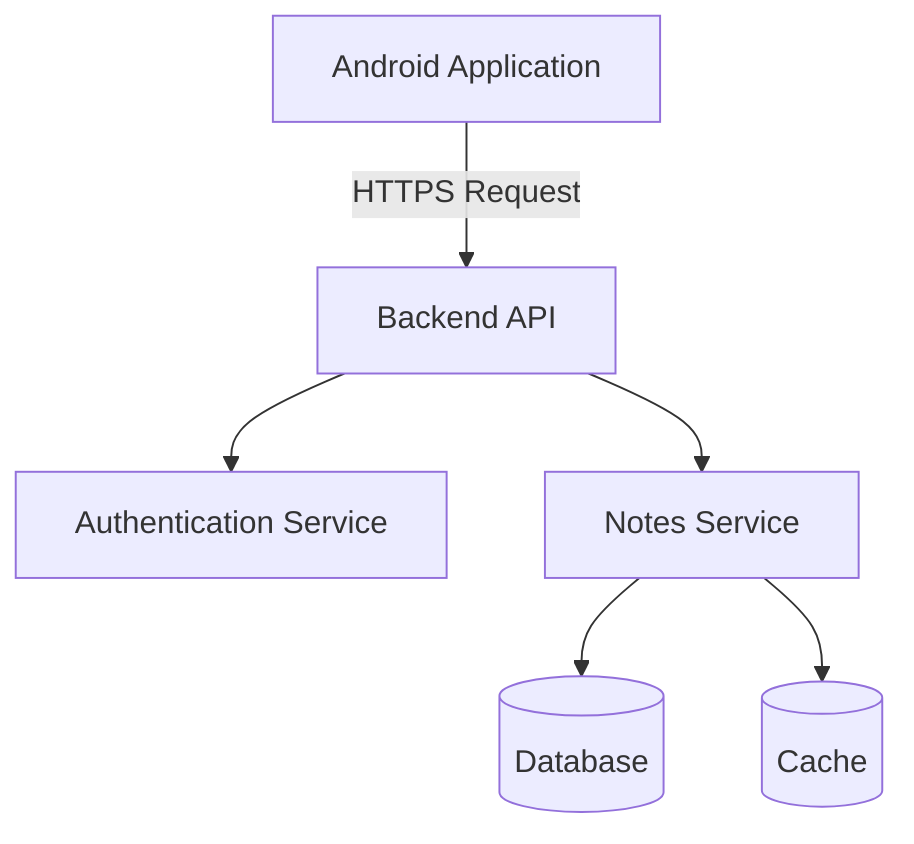
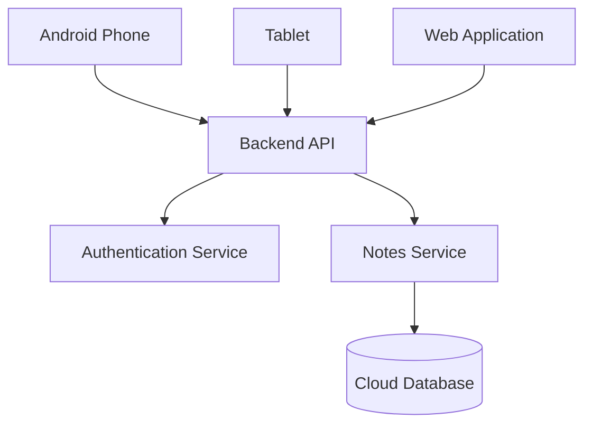

Let's begin with your first complete study document.

This document is written for someone who has never studied system design before. Read it from top to bottom. Don't skip the basic explanations.

Week 1Day 1Beginner level

# Day 1 – System Design Fundamentals

File name: `Day-1-System-Design-Fundamentals.md`

What you will learn today

1. What is system design?
2. Why do we need system design?
3. What is HLD (High-Level Design)?
4. What is LLD (Low-Level Design)?
5. Functional requirements.
6. Non-functional requirements.
7. How to approach a system design interview.
8. Practical example: Designing a Notes application.

Complete Markdown study notes

Writing

# Day 1 – System Design Fundamentals

**Week:** 1 – System Design Basics\
**Level:** Beginner\
**Target:** Software engineers preparing for system design interviews\
**Example used throughout:** Notes Application

---

# 1\. Introduction to System Design

## 1.1 What is System Design?

Before understanding system design, let's understand what a software system is.

A software system is a collection of different components that work together to provide a particular service or solve a problem.

For example, consider a Notes application.

A Notes application allows users to:

- Create notes.
- Edit notes.
- Delete notes.
- View saved notes.
- Search for notes.

To build this application, we need several components:

1. A mobile application where users interact with the system.
2. A database where notes are stored.
3. Business logic to process user operations.
4. APIs to communicate between the mobile application and backend.

All these components work together to provide the Notes application.

**System Design** is the process of deciding how these components should be organized, how they communicate, where data is stored, and how the complete system should work.

### Simple definition

System design is the process of planning the architecture, components, databases, communication and interactions of a software system before or during implementation.

## 1.2 Why Do We Need System Design?

Let's understand this using two scenarios.

### Scenario 1: Building an application for one user

Imagine you want to build a simple Notes application for personal use.

Requirements:

- Create notes.
- Edit notes.
- Delete notes.
- View notes.

You decide to use:

- Kotlin for development.
- Jetpack Compose for UI.
- MVVM for application architecture.
- Room Database for local storage.

Your architecture could look like this:

text

```text
        Android Application
                 |
                 v
             UI Screen
                 |
                 v
             ViewModel
                 |
                 v
             Repository
                 |
                 v
           Room Database
```

This architecture works perfectly well for an offline Notes application.

Why?

Because:

- Only one user uses the application.
- Data is stored locally.
- No backend server is required.
- There is no need to synchronize data across devices.

### Scenario 2: Building an application for 10 million users

Now imagine your Notes application becomes popular.

You have 10 million users.

Users want to:

- Access notes from multiple devices.
- Synchronize notes automatically.
- Back up notes to the cloud.
- Share notes with other users.
- Access notes from anywhere.

Your previous architecture is no longer sufficient.

Why?

Room Database stores data locally on an individual device.

If a user installs the application on another device, their notes won't automatically appear there.

You now need additional components:

- Backend servers.
- REST APIs.
- Cloud databases.
- Authentication.
- Data synchronization.
- Caching.
- Load balancing.
- Security mechanisms.

The architecture becomes:

text

```text
             Android App
                  |
                  |
                HTTPS
                  |
                  v
             Backend API
                  |
          +-------+-------+
          |               |
          v               v
     Authentication   Notes Service
                          |
                          v
                      Database
```

Now the application is not just an Android application.

It is a complete software system.

Planning how these components work together is system design.

## 1.3 System Design vs Android Application Architecture

As an Android developer, you may already know:

- MVVM.
- MVI.
- Clean Architecture.
- Repository Pattern.
- Dependency Injection.
- Room Database.
- Retrofit.

These are important concepts, but they are not the entire system design.

| Android Architecture | System Design |
| --- | --- |
| Focuses on Android application structure | Focuses on the complete software system |
| MVVM, MVI, Clean Architecture | Client-server architecture, distributed systems |
| ViewModel | Backend services and system components |
| Room Database | Cloud databases and distributed storage |
| Retrofit | API communication between components |
| Dependency Injection | Component dependencies and architecture |

**Important:** Android application architecture is one part of a larger system.

---

# 2\. Types of System Design

System design is commonly discussed at two levels:

1. High-Level Design (HLD).
2. Low-Level Design (LLD).

Understanding the difference is important for interviews.

# 3\. High-Level Design (HLD)

## 3.1 What is HLD?

HLD stands for High-Level Design.

It describes the overall architecture of a software system.

It focuses on:

- Major components.
- Services.
- Databases.
- Communication between components.
- Data flow.
- Technology selection.
- Scalability and availability considerations.

HLD does not focus on individual Kotlin classes or methods.

Think of HLD as creating a blueprint of a building.

Before constructing a building, an architect decides:

- How many floors are needed?
- Where should the rooms be?
- Where should the staircase be?
- Where should the entrance be?

Similarly, before developing a large software system, engineers decide:

- What components are required?
- How will they communicate?
- Where will data be stored?
- How will the system handle more users?

## 3.2 HLD Example: Notes Application

Imagine an interviewer asks:

"Design a Notes application."

You start by identifying the major components.

### Component 1: Android Application

This is where users interact with the application.

Responsibilities:

- Display notes.
- Create notes.
- Edit notes.
- Delete notes.
- Send API requests.
- Display responses.

### Component 2: Backend Server

The backend server receives requests from the Android application.

Responsibilities:

- Process API requests.
- Validate input.
- Apply business rules.
- Communicate with the database.
- Return responses.

### Component 3: Database

The database stores application data.

For example:

- User information.
- Notes.
- Note creation time.
- Note update time.

### Component 4: Authentication Service

Authentication verifies the identity of a user.

For example:

- Login.
- Logout.
- Token generation.
- Token validation.

### Component 5: Cache

A cache stores frequently accessed information temporarily so that it can be retrieved faster.

For example, recently accessed notes might be cached.

We will study caching in detail later.

## 3.3 HLD Architecture Diagram

mermaid



Explanation:

1. The user opens the Android application.
2. The application sends a request to the backend.
3. The backend validates the user's authentication.
4. The Notes Service processes the request.
5. The service retrieves or stores information.
6. The backend returns a response to Android.

This is an example of HLD.

We are discussing the major components and their communication.

We are not discussing the implementation of individual classes.

## 3.4 Important HLD Decisions

During HLD, engineers make decisions such as:

- Should we use SQL or NoSQL?
- Should we use a monolithic architecture or microservices?
- Do we need caching?
- How should the system handle millions of users?
- How should we manage user authentication?
- How should data be synchronized across devices?

These decisions influence the overall architecture.

---

# 4\. Low-Level Design (LLD)

## 4.1 What is LLD?

LLD stands for Low-Level Design.

It describes the internal implementation of individual components.

It focuses on:

- Classes.
- Interfaces.
- Methods.
- Objects.
- Data models.
- Design patterns.
- Relationships between classes.
- Code-level responsibilities.

Think of HLD as the building blueprint.

LLD is the detailed plan for constructing each room, including the doors, windows, electrical connections and other internal details.

## 4.2 LLD Example: Notes Application

Suppose the interviewer asks:

"How would you implement the Notes module in Kotlin?"

Now you need to think about the code structure.

### Step 1: Create a Note model

kotlin

```kotlin
data class Note(
    val id: String,
    val title: String,
    val description: String,
    val createdAt: Long,
    val updatedAt: Long
)
```

This class represents a note.

### Step 2: Create a Repository interface

kotlin

```kotlin
interface NoteRepository {

    suspend fun getNotes(): List<Note>

    suspend fun createNote(note: Note)

    suspend fun updateNote(note: Note)

    suspend fun deleteNote(id: String)
}
```

The repository defines the operations available for working with notes.

### Step 3: Create a Repository implementation

kotlin

```kotlin
class NoteRepositoryImpl(
    private val noteDao: NoteDao
) : NoteRepository {

    override suspend fun getNotes(): List<Note> {
        return noteDao.getNotes()
    }

    override suspend fun createNote(note: Note) {
        noteDao.insert(note)
    }

    override suspend fun updateNote(note: Note) {
        noteDao.update(note)
    }

    override suspend fun deleteNote(id: String) {
        noteDao.delete(id)
    }
}
```

This class implements the repository operations.

### Step 4: Create a ViewModel

kotlin

```kotlin
class NoteViewModel(
    private val repository: NoteRepository
) : ViewModel() {

    fun loadNotes() {
        viewModelScope.launch {
            val notes = repository.getNotes()
            // Update UI state
        }
    }
}
```

The ViewModel interacts with the repository and manages UI-related state.

This is an example of LLD because we are discussing the internal implementation of a component.

## 4.3 HLD vs LLD Comparison

| Category | HLD | LLD |
| --- | --- | --- |
| Full form | High-Level Design | Low-Level Design |
| Focus | Overall system architecture | Internal component implementation |
| Components | Servers, services, databases | Classes, interfaces, methods |
| Database | Choosing SQL or NoSQL | Designing tables and columns |
| API | Deciding API communication | Defining endpoint contracts |
| Diagrams | Architecture diagrams | UML and class diagrams |
| Main concern | System architecture and scalability | Code organization and maintainability |

## 4.4 When Do We Use HLD and LLD?

HLD is particularly important when:

- Designing large applications.
- Designing distributed systems.
- Preparing for system design interviews.
- Deciding system architecture.
- Planning scalability.

LLD is particularly important when:

- Designing classes and interfaces.
- Implementing application modules.
- Applying design patterns.
- Writing maintainable code.
- Preparing for object-oriented design interviews.

### Interview Question: What is the difference between HLD and LLD?

**Answer:**

HLD describes the overall architecture of a system, including major components, services, databases and communication mechanisms.

LLD describes the internal implementation of individual components, including classes, interfaces, methods and design patterns.

For example, selecting a database and deciding how backend services communicate comes under HLD.

Designing a NoteRepository interface and its implementation in Kotlin comes under LLD.

---

# 5\. Requirements in System Design

Before designing any system, we must understand its requirements.

A requirement describes something that the system should provide or satisfy.

For example, if we are designing a Notes application, we need to understand:

- What should users be able to do?
- How quickly should the application respond?
- How many users should the system support?
- How secure should the data be?

System requirements are commonly divided into two categories:

1. Functional Requirements.
2. Non-Functional Requirements.

# 6\. Functional Requirements

## 6.1 What are Functional Requirements?

Functional requirements describe WHAT a system should do.

They define the features and operations that the system must provide to users.

In simple words:

Functional requirements describe the actual functionality of an application.

## 6.2 Functional Requirements Example: Notes Application

Imagine we are building a Notes application.

What should users be able to do?

### FR1: Create a note

Users should be able to create a new note.

Example:

- Enter a title.
- Enter a description.
- Click Save.
- The note should be stored.

### FR2: View notes

Users should be able to view their saved notes.

Example:

- Open the Notes screen.
- Display the list of saved notes.

### FR3: Edit a note

Users should be able to modify an existing note.

Example:

- Open a note.
- Change its title.
- Change its description.
- Save the changes.

### FR4: Delete a note

Users should be able to delete notes they no longer need.

### FR5: Search notes

Users should be able to search notes using keywords.

### FR6: Pin notes

Users should be able to pin important notes so that they appear at the top.

### FR7: Synchronize notes

Users should be able to access the same notes across multiple devices.

### FR8: Share notes

Users should be able to share notes with other users.

## 6.3 Functional Requirements Summary

| ID | Requirement | Description |
| --- | --- | --- |
| FR1 | Create note | Create and save a note |
| FR2 | View notes | Display saved notes |
| FR3 | Edit note | Modify an existing note |
| FR4 | Delete note | Remove a note |
| FR5 | Search notes | Find notes using keywords |
| FR6 | Pin note | Keep important notes at the top |
| FR7 | Sync notes | Access notes across devices |
| FR8 | Share notes | Share notes with other users |

## 6.4 How Do We Identify Functional Requirements in Interviews?

When an interviewer asks you to design a system, don't immediately start drawing diagrams.

First understand what the system should do.

Ask questions such as:

- What are the main features?
- Who are the users?
- Can users create and delete information?
- Do users need to search?
- Is sharing required?
- Is offline access required?

These questions help define the scope of the system.

**Scope** means deciding what is included in the system and what is outside its responsibility.

For example, if the interviewer asks you to design a Notes application, you should not automatically assume that you also need video calling, payments or social networking.

Start with the requirements that are actually relevant.

---

# 7\. Non-Functional Requirements

## 7.1 What are Non-Functional Requirements?

Non-functional requirements describe HOW WELL a system should work.

They define the quality attributes, performance expectations and operational constraints of the system.

A system can have all the required features and still be a bad system.

Let's understand this with an example.

Imagine your Notes application supports:

- Creating notes.
- Editing notes.
- Deleting notes.
- Searching notes.

All features are working.

However:

- Opening a note takes 15 seconds.
- The application stops working when many users access it.
- Users sometimes lose their notes.
- Unauthorized users can access private notes.

The application provides the required features, but it does not provide a good experience.

This is why non-functional requirements are important.

## 7.2 Important Non-Functional Requirements

### 1\. Performance

Performance describes how efficiently a system responds to user requests.

Example:

When a user opens a note, it should load quickly.

Poor performance:

- A note takes 10 seconds to load.
- Searching notes takes too long.
- APIs respond slowly.

Good performance:

- Notes load quickly.
- Search results appear quickly.
- API responses are efficient.

Performance is commonly measured using response time, latency and resource usage.

### 2\. Scalability

Scalability is the ability of a system to handle increasing workloads.

Workload can increase because of:

- More users.
- More API requests.
- More stored data.
- More simultaneous operations.

Example:

Today, your Notes application has 1,000 users.

After one year, it has 10 million users.

Can your system handle the increase in users and requests?

If the system can grow to handle increased demand, it is scalable.

We will study scalability in detail in Day 2.

### 3\. Availability

Availability describes how often a system is operational and accessible when users need it.

Imagine a Notes application.

Users expect to access their notes at any time.

But suppose the backend server stops working.

Users may not be able to access their cloud notes.

A highly available system is designed to minimize downtime and continue serving users even when some components fail.

Availability is commonly expressed as a percentage.

| Availability | Approximate downtime per year |
| --- | --- |
| 99% | 3 days, 15 hours and 36 minutes |
| 99.9% | 8 hours and 46 minutes |
| 99.99% | 52 minutes and 34 seconds |
| 99.999% | 5 minutes and 15 seconds |

Higher availability generally means less downtime.

### 4\. Reliability

Reliability describes the ability of a system to operate correctly and consistently over time.

Example:

A user creates a note and saves it.

The system should store the note correctly.

It should not:

- Randomly lose the note.
- Corrupt the note.
- Return incorrect information.
- Fail unexpectedly during normal operations.

Reliability is about dependable and correct operation.

### Availability vs Reliability

These concepts are related, but they are not identical.

Availability asks:

"Is the system accessible?"

Reliability asks:

"Does the system work correctly and consistently?"

Example:

A server may be accessible 99.9% of the time but occasionally return incorrect data.

It may have good availability but poor reliability.

### 5\. Security

Security protects the system and its data from unauthorized access and misuse.

For a Notes application:

- Users should only access their own private notes.
- Passwords should not be stored as plain text.
- API communication should be protected using HTTPS.
- Authentication tokens should be handled securely.
- Sensitive information should be protected.

Important security concepts:

- Authentication.
- Authorization.
- Encryption.
- Access control.

Authentication verifies WHO the user is.

Authorization determines WHAT the user is allowed to access or perform.

Example:

A user successfully logs in.

Authentication is successful.

But that user should not automatically be allowed to access another user's private notes.

Authorization controls that access.

### 6\. Maintainability

Maintainability describes how easily a system can be modified, fixed and extended.

Imagine your Notes application initially supports:

- Create notes.
- Edit notes.
- Delete notes.

Now the business asks you to add:

- Note sharing.
- Image attachments.
- Voice notes.

If your architecture is well organized, adding these features should be manageable.

If everything is tightly coupled and poorly structured, even small changes can become difficult.

Good maintainability helps developers:

- Fix bugs.
- Add new features.
- Modify existing functionality.
- Understand the codebase.
- Test components.

### 7\. Consistency

Consistency means users should see correct and compatible data across the system.

Example:

A user edits a note on their phone.

Later, they open the same account on their tablet.

They should see the updated note.

The system needs a synchronization strategy to ensure that updates are reflected correctly.

We will study consistency in more detail in later system design topics.

## 7.3 Non-Functional Requirements Summary

| Requirement | Meaning | Notes Application Example |
| --- | --- | --- |
| Performance | Fast response | Notes load quickly |
| Scalability | Handle increasing workload | Support millions of users |
| Availability | Accessible when needed | Minimize service downtime |
| Reliability | Work correctly over time | Don't lose saved notes |
| Security | Protect data | Prevent unauthorized access |
| Maintainability | Easy to modify | Easily add new features |
| Consistency | Maintain correct data | Sync updates across devices |

---

# 8\. Functional vs Non-Functional Requirements

This is one of the most common beginner interview questions.

Let's compare them.

| Functional Requirements | Non-Functional Requirements |
| --- | --- |
| Describe what the system does | Describe how well the system works |
| Define features | Define quality attributes and constraints |
| Create a note | Fast note creation |
| Delete a note | Reliable deletion |
| Search notes | Fast search |
| Share notes | Secure sharing |
| Synchronize notes | Consistent synchronization |

### Easy way to remember

Functional = WHAT

Non-functional = HOW WELL

Example:

Functional requirement:

"Users should be able to search for notes."

Non-functional requirement:

"Search results should be returned within an acceptable response time."

Both requirements are important.

One defines the functionality, and the other defines its expected quality.

---

# 9\. How to Approach a System Design Interview

Suppose the interviewer asks:

"Design a Notes application."

A beginner may immediately start drawing an architecture diagram.

But an experienced engineer first understands the requirements.

A good starting process is:

## Step 1: Understand the problem

Clarify what the interviewer expects.

Example:

- Are we designing a mobile application?
- Are we designing a complete cloud-based Notes system?
- Is offline access required?

## Step 2: Gather functional requirements

Identify the features.

Example:

- Create notes.
- Edit notes.
- Delete notes.
- Search notes.
- Synchronize notes.

## Step 3: Gather non-functional requirements

Understand the quality expectations.

Example:

- Fast response.
- High availability.
- Scalability.
- Security.
- Reliability.

## Step 4: Define the scope

Decide what features you will design and what features are outside the current discussion.

## Step 5: Start High-Level Design

Identify:

- Client applications.
- Backend services.
- Databases.
- Cache.
- Communication mechanisms.

## Step 6: Discuss design decisions

Explain why you selected particular components and technologies.

For example:

"Since users need to access notes across multiple devices, I would use a backend service and cloud database. I would also maintain local storage on Android to support offline access."

This shows that you understand the problem rather than simply memorizing architecture diagrams.

---

# 10\. Practical Example: Requirements for a Notes Application

Let's combine everything we learned.

Assume we are designing a cloud-based Notes application.

## 10.1 Problem Statement

Design a Notes application that allows users to create, view, edit, delete and synchronize notes across multiple devices.

## 10.2 Functional Requirements

1. Users can register and log in.
2. Users can create notes.
3. Users can view their notes.
4. Users can edit existing notes.
5. Users can delete notes.
6. Users can search notes.
7. Users can access notes from multiple devices.
8. Users can synchronize notes.

## 10.3 Non-Functional Requirements

1. Performance: Notes should load quickly.
2. Scalability: The system should support increasing numbers of users.
3. Availability: Users should be able to access notes reliably.
4. Reliability: Saved notes should not be lost.
5. Security: Users should only access authorized notes.
6. Maintainability: New features should be easy to introduce.
7. Consistency: Updates should be reflected correctly across devices.

## 10.4 Initial High-Level Architecture

mermaid



Explanation:

1. Users interact with Android, tablet or web applications.
2. Applications communicate with the backend API.
3. Authentication Service verifies users.
4. Notes Service processes note operations.
5. Cloud Database stores note information.

This is only an initial architecture.

We will improve this architecture as we learn about APIs, databases, caching, scalability and synchronization.

---

# 11\. Interview Questions and Answers

## Q1. What is system design?

**Answer:**

System design is the process of planning the architecture, components, databases and communication mechanisms of a software system to satisfy functional and non-functional requirements.

It helps us build systems that are scalable, reliable, maintainable and secure.

## Q2. What is the difference between HLD and LLD?

**Answer:**

HLD focuses on the overall architecture of a system, including components, services, databases and communication.

LLD focuses on the internal implementation of those components, including classes, interfaces, methods and design patterns.

## Q3. What are functional requirements?

**Answer:**

Functional requirements describe the features and operations a system must provide.

For example, a Notes application should allow users to create, edit, delete and search notes.

## Q4. What are non-functional requirements?

**Answer:**

Non-functional requirements describe the quality attributes and constraints of a system.

Examples include performance, scalability, availability, reliability, security and maintainability.

## Q5. Why are non-functional requirements important?

**Answer:**

Non-functional requirements help ensure that the system not only provides the required features but also works efficiently and reliably.

For example, an application may support note creation, but if saving a note takes 15 seconds, users will have a poor experience.

## Q6. What is the difference between availability and reliability?

**Answer:**

Availability describes whether a system is accessible when users need it.

Reliability describes whether the system performs its intended operations correctly and consistently over time.

A system can be available but still return incorrect results.

## Q7. Why should we gather requirements before designing a system?

**Answer:**

Gathering requirements helps us understand the actual problem, define the scope and identify the system's expected behavior.

It prevents unnecessary complexity and helps us select the right architecture.

## Q8. Is MVVM a system design concept?

**Answer:**

MVVM is an application architecture pattern used to organize UI-related code.

It is generally part of application-level design rather than the overall system architecture.

System design covers a broader scope, including clients, backend services, databases, communication and infrastructure.

---

# 12\. Day 1 Revision Summary

Let's revise everything.

| Concept | Remember |
| --- | --- |
| System Design | Planning the complete software system |
| HLD | Overall architecture |
| LLD | Internal implementation |
| Functional Requirements | What the system should do |
| Non-Functional Requirements | How well the system should work |
| Performance | How efficiently the system responds |
| Scalability | Ability to handle increasing workload |
| Availability | Accessibility of the system |
| Reliability | Correct and consistent operation |
| Security | Protection of the system and data |
| Maintainability | Ease of modifying the system |
| Consistency | Correct and compatible data across the system |

## Most Important Things to Remember

1. HLD is about the overall architecture.
2. LLD is about implementation details.
3. Functional requirements define features.
4. Non-functional requirements define quality attributes and constraints.
5. Always understand requirements before designing architecture.
6. System design is broader than Android application architecture.

---

# 13\. Day 1 Self-Assessment

Try answering these questions without looking at the notes.

### Basic Understanding

1. What is system design?
2. Why do we need system design?
3. What is the difference between Android architecture and system design?
4. What is HLD?
5. What is LLD?

### Requirements

6. What are functional requirements?
7. What are non-functional requirements?
8. List five functional requirements for a Notes application.
9. List five non-functional requirements for a Notes application.
10. What is the difference between availability and reliability?

### Practical Thinking

11. Why is Room Database alone insufficient for synchronizing notes across multiple devices?
12. If an application supports millions of users, which non-functional requirement becomes important?
13. If a user can access another user's private notes, which requirement is violated?
14. If notes take 10 seconds to load, which requirement is not being met?
15. Why should we gather requirements before starting HLD?

---

# 14\. What You Should Be Able to Do After Day 1

By the end of this lesson, you should be able to:

- Explain system design in simple words.
- Differentiate HLD and LLD.
- Identify functional requirements.
- Identify non-functional requirements.
- Explain the difference between availability and reliability.
- Gather basic requirements for a Notes application.
- Explain why an Android application may need a backend system.

**End of Day 1 – System Design Fundamentals**

**Next:** Day 2 – System Quality Attributes: Latency, Throughput, Scalability, Availability and Reliability.

How to use these notes: Save this document as `Day-1-System-Design-Fundamentals.md`. Read one section at a time, and try explaining each concept aloud without looking at the document.

Tomorrow's topics will build directly on today's foundation.
