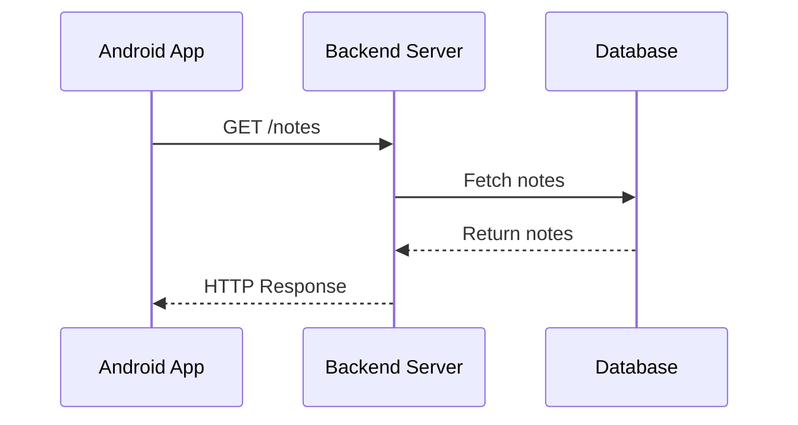
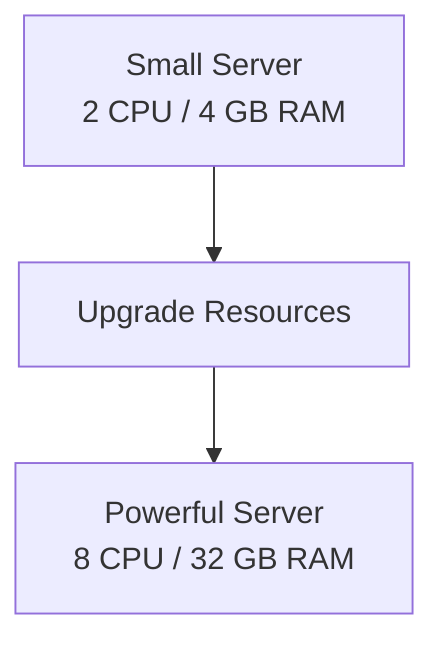
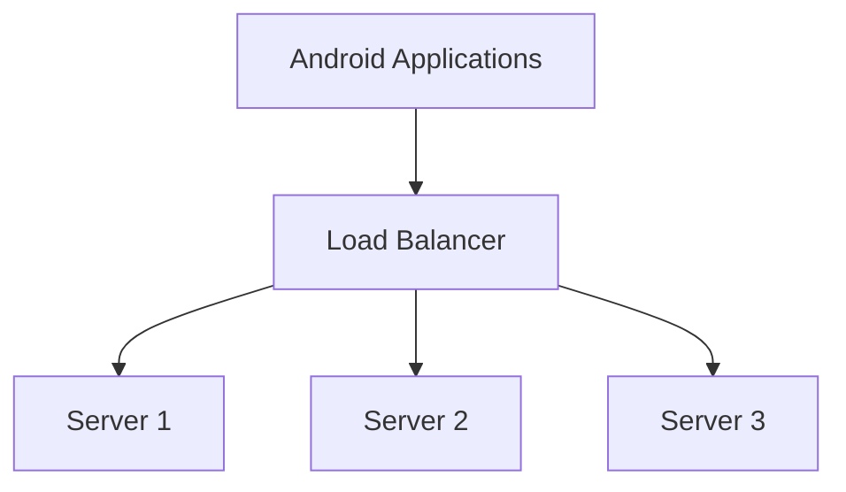

# Week 1 – Day 2: System Quality Attributes

Week 1Day 2Beginner level

File name: `Day-2-System-Quality-Attributes.md`

Today's topics:

1. Latency
2. Throughput
3. Scalability
4. Availability
5. Reliability
6. Fault Tolerance
7. Performance
8. Horizontal vs Vertical Scaling
9. Real-world examples and interview questions

These concepts are extremely important in system design interviews. Interviewers often ask questions such as:

- How will you handle 1 million users?
- How will you reduce API response time?
- What happens if your server goes down?
- How will you make your application highly available?
- How will you handle increasing traffic?

Today, we will understand the fundamentals behind answering these questions.

Writing

# Day 2 – System Quality Attributes

**Week:** 1 – System Design Basics\
**Level:** Beginner\
**Previous topic:** Day 1 – System Design Fundamentals\
**Example used throughout:** Notes Application

---

# 1\. Introduction to System Quality Attributes

## 1.1 What are System Quality Attributes?

On Day 1, we learned about functional and non-functional requirements.

Functional requirements describe what a system should do.

For example:

- Create a note.
- Edit a note.
- Delete a note.
- Search notes.

But imagine we have developed all these features.

The application works, but:

- Opening notes takes 10 seconds.
- The server crashes when too many users access it.
- Users cannot access their notes when one server fails.
- The application sometimes loses saved data.

The application has the required features, but its quality is poor.

This is why we need system quality attributes.

System quality attributes describe how well a software system performs its responsibilities.

Some important quality attributes are:

1. Latency.
2. Throughput.
3. Scalability.
4. Availability.
5. Reliability.
6. Fault tolerance.
7. Performance.

Let's understand each one using simple examples.

---

# 2\. Latency

## 2.1 What is Latency?

Latency is the amount of time taken to complete an operation or respond to a request.

In simple words:

**Latency tells us how long a user has to wait for a response.**

Example:

Imagine you open your Notes application and tap on a note.

The application sends a request to the backend.

The backend retrieves the note from the database and sends the response.

Suppose the entire operation takes 500 milliseconds.

Then the request latency is approximately 500 milliseconds, assuming we measure from the time the request starts until the response arrives.

## 2.2 Real-World Example

Consider these three situations:

| Operation | Time taken |
| --- | --- |
| Open a note | 100 ms |
| Search notes | 500 ms |
| Load a large file | 3000 ms |

The first operation is faster than the second and third.

Generally, lower latency means users receive responses faster.

## 2.3 How Does Latency Work in an Android Application?

Suppose your Android application uses Retrofit to call an API.

kotlin

```kotlin
interface NotesApi {

    @GET("notes")
    suspend fun getNotes(): List<Note>
}
```

When you call:

kotlin

```kotlin
val notes = notesApi.getNotes()
```

Several things happen:

1. Android creates an HTTP request.
2. The request travels through the network.
3. The backend receives the request.
4. The backend processes it.
5. The backend may query a database.
6. The database returns the data.
7. The backend creates an HTTP response.
8. The response travels back to Android.
9. Android processes the response.

The time taken for this complete request-response operation is its latency.

mermaid



## 2.4 What Causes High Latency?

Some common reasons:

### 1\. Slow network

The user's internet connection may be slow.

### 2\. Slow database queries

The database may take too long to retrieve records.

### 3\. Heavy backend processing

The server may perform expensive calculations.

### 4\. Large response payloads

Sending unnecessary data increases network transfer time.

### 5\. Too many network calls

The application may make multiple unnecessary API requests.

### 6\. Server overload

The backend may be processing too many requests simultaneously.

## 2.5 How Can We Reduce Latency?

Some common approaches:

- Use caching.
- Optimize database queries.
- Reduce unnecessary API calls.
- Compress large responses where appropriate.
- Avoid sending unnecessary fields.
- Use pagination for large datasets.
- Improve network communication.
- Optimize backend processing.

Example:

Instead of downloading 10,000 notes at once, request only the first 20 notes.

This can reduce the amount of data transferred and improve the time required to display the first page.

We will study caching and pagination in detail later.

## 2.6 Latency vs Response Time

These terms are sometimes used interchangeably in casual discussions, but they can have different meanings depending on the measurement context.

- Latency usually describes the delay involved in an operation or request.
- Response time usually describes the total time between sending a request and receiving its response.

For a simple API request, the measured end-to-end latency and response time may be approximately the same.

In a complex system, engineers may measure individual network, queueing and processing delays separately.

**Interview definition:**

Latency is the time taken for a request or operation to receive a response. Lower latency generally provides a faster user experience.

---

# 3\. Throughput

## 3.1 What is Throughput?

Throughput is the number of operations or requests a system can successfully process within a given amount of time.

In simple words:

**Throughput tells us how much work a system can handle per second.**

Example:

Imagine your Notes backend processes:

- 100 API requests in one second.

Its throughput during that interval is:

100 requests per second (RPS).

Suppose another backend processes:

- 1,000 API requests in one second.

Its throughput is:

1,000 requests per second.

The second backend is processing more requests per second.

## 3.2 Real-World Example

Imagine an online shopping application.

During normal hours:

- 100 users place requests per second.

During a festival sale:

- 10,000 users place requests per second.

The backend must handle the increased workload.

If it can process 10,000 requests every second, its throughput is 10,000 requests per second under that workload.

## 3.3 How Is Throughput Measured?

Throughput depends on the type of system.

| System | Throughput measurement |
| --- | --- |
| REST API | Requests per second (RPS) |
| Database | Queries or transactions per second |
| Network | Bits per second |
| Message processing | Messages per second |
| File processing | Files per second |

## 3.4 Throughput Example: Notes Application

Suppose your Notes backend receives:

| Time | Requests received |
| --- | --- |
| 1 second | 100 |
| 1 second | 500 |
| 1 second | 1,000 |
| 1 second | 5,000 |

If the backend successfully processes 5,000 requests in one second, its throughput for that interval is 5,000 requests per second.

Important: Receiving 5,000 requests does not necessarily mean successfully processing all 5,000.

We should distinguish between incoming traffic and successfully completed work.

## 3.5 What Affects Throughput?

- Server CPU and memory.
- Database performance.
- Network bandwidth.
- Number of concurrent requests.
- Application implementation.
- External service dependencies.
- Request complexity.

## 3.6 How Can We Increase Throughput?

Some approaches:

1. Optimize application code.
2. Improve database performance.
3. Use caching to reduce repeated database work.
4. Add more servers.
5. Use load balancing.
6. Process independent operations concurrently.
7. Reduce unnecessary work.

We will learn load balancing and caching in later lessons.

---

# 4\. Latency vs Throughput

This is one of the most important interview concepts.

These two terms are related but describe different things.

### Latency

How long does one operation take?

### Throughput

How many operations can the system process in a given amount of time?

Imagine a restaurant.

- Latency = Time taken to prepare and serve one customer's order.
- Throughput = Number of customer orders the restaurant can serve in one hour.

Example:

Restaurant A:

- One order takes 5 minutes.
- It serves 12 orders per hour with one preparation station.

Restaurant B:

- One order takes 5 minutes.
- It has 5 preparation stations working independently.
- It can serve up to 60 orders per hour under ideal conditions.

Both restaurants may have similar individual order latency, but different throughput.

The same idea applies to backend systems.

| Latency | Throughput |
| --- | --- |
| Time taken per operation | Number of operations per unit of time |
| Usually measured in ms or seconds | Usually measured in RPS or TPS |
| Lower is generally better | Higher is generally better |
| Focuses on response delay | Focuses on processing capacity |

**Important:** Increasing throughput does not automatically reduce latency.

A system may process many requests simultaneously but still take a long time to complete each request.

Similarly, a system may have low latency for individual requests but support only a small number of simultaneous users.

## Interview Question

**Q: What is the difference between latency and throughput?**

Answer:

Latency measures the time required to complete an operation or receive a response.

Throughput measures the number of operations a system can process within a given period.

For example, an API may have an average latency of 200 milliseconds and process 1,000 requests per second.

These measurements describe different aspects of system performance.

---

# 5\. Scalability

## 5.1 What is Scalability?

Scalability is the ability of a system to handle increasing workloads by adding or adjusting resources.

Workload can increase because of:

- More users.
- More requests.
- More stored data.
- More concurrent operations.

Example:

Today your Notes application has 1,000 users.

After one year, it has 1 million users.

After another year, it has 10 million users.

Your system should be able to grow and handle the increasing demand.

This ability is called scalability.

## 5.2 Why Do We Need Scalability?

Imagine you have developed a backend server.

Initially, it handles 100 users without any problem.

But as the application becomes popular:

- More users log in.
- More users create notes.
- More users search notes.
- More users synchronize data.

The server receives more requests.

Eventually:

- CPU usage increases.
- Memory usage increases.
- Database queries become slower.
- Requests start timing out.
- Some users experience failures.

We need a way to increase the system's capacity.

There are two common scaling approaches:

1. Vertical Scaling.
2. Horizontal Scaling.

---

# 6\. Vertical Scaling

## 6.1 What is Vertical Scaling?

Vertical scaling means increasing the resources of an existing server.

For example:

- Increase CPU cores.
- Increase RAM.
- Use faster storage.
- Upgrade the machine.

Imagine your backend is running on a server with:

- 2 CPU cores.
- 4 GB RAM.

As traffic increases, you upgrade it to:

- 8 CPU cores.
- 32 GB RAM.

You have made the same server more powerful.

This is vertical scaling.

## 6.2 Diagram

mermaid



## 6.3 Advantages of Vertical Scaling

1. Easy to understand.
2. Usually requires fewer architecture changes.
3. Can improve the capacity of existing applications.
4. Simpler to operate in many cases.

## 6.4 Disadvantages of Vertical Scaling

1. Hardware resources have limits.
2. Powerful machines can become expensive.
3. A single server may remain a single point of failure.
4. Upgrading may require maintenance or downtime.

A single point of failure is a component whose failure can cause the entire dependent system to stop working.

---

# 7\. Horizontal Scaling

## 7.1 What is Horizontal Scaling?

Horizontal scaling means adding more servers or machines to handle increasing workloads.

Instead of making one server more powerful, we add multiple servers.

Example:

Initially:

One backend server handles all requests.

As traffic increases, we add two more backend servers.

Now three servers share the incoming traffic.

This is horizontal scaling.

## 7.2 Diagram

mermaid



Here, the load balancer distributes incoming requests across available servers.

We will study load balancing in more detail later.

## 7.3 Advantages of Horizontal Scaling

1. Can handle increasing traffic by adding servers.
2. Supports distributing workloads.
3. Can improve availability when designed with redundancy.
4. Allows gradual capacity expansion.

## 7.4 Disadvantages of Horizontal Scaling

1. More complex architecture.
2. Requires coordination between servers.
3. Distributed data management becomes more complicated.
4. Monitoring and debugging become more challenging.
5. Additional infrastructure costs.

## 7.5 Vertical vs Horizontal Scaling

| Category | Vertical Scaling | Horizontal Scaling |
| --- | --- | --- |
| Meaning | Increase resources of one server | Add more servers |
| Example | Upgrade 4 GB RAM to 32 GB | Add three backend servers |
| Complexity | Usually simpler | Usually more complex |
| Resource limit | Limited by machine capacity | Can expand by adding machines |
| Redundancy | Not provided automatically | Can support redundancy |
| Cost | Powerful machines can be expensive | Additional machines also cost money |

**Important interview point:**

Horizontal scaling is commonly used in large distributed systems because it allows capacity to grow by adding machines.

However, horizontal scaling introduces additional complexity.

It is not automatically better for every application.

---

# 8\. Availability

## 8.1 What is Availability?

Availability describes the percentage of time a system is operational and accessible when users need it.

In simple words:

Availability answers this question:

"Can users access the system when they want to?"

Imagine your Notes application has a backend server.

One day, the server crashes.

Users cannot access their cloud notes.

The system is unavailable during that period.

A highly available system is designed to minimize downtime and continue serving requests when individual components fail.

## 8.2 Availability Percentage

Availability is commonly expressed as a percentage.

For example:

- 99% availability.
- 99.9% availability.
- 99.99% availability.
- 99.999% availability.

The more 9s we have, the higher the availability.

## 8.3 Understanding Downtime

Downtime means the period during which a system is unavailable.

Approximate annual downtime:

| Availability | Annual downtime |
| --- | --- |
| 99% | 3 days 15 hours 36 minutes |
| 99.9% | 8 hours 45 minutes 36 seconds |
| 99.99% | 52 minutes 34 seconds |
| 99.999% | 5 minutes 15 seconds |

For example:

If your Notes service promises 99.9% availability, the corresponding annual downtime budget is approximately 8 hours and 46 minutes.

## 8.4 How Do We Improve Availability?

### 1\. Multiple Servers

Instead of depending on one backend server, use multiple servers.

If one server fails, another may continue handling requests.

### 2\. Load Balancer

A load balancer distributes requests across multiple servers.

It can also stop sending traffic to unhealthy servers when configured with health checks.

### 3\. Redundancy

Redundancy means having additional components available to take over when primary components fail.

For example:

- Multiple backend servers.
- Replicated databases.
- Backup infrastructure.

### 4\. Monitoring

Monitor system health to identify failures quickly.

Examples:

- CPU usage.
- Memory usage.
- Server health.
- API error rates.
- Database availability.

### 5\. Automatic Recovery

Some systems automatically restart failed services or replace unhealthy machines.

## 8.5 Example: Notes Application

Without redundancy:

text

```text
Android App
     |
     v
Backend Server
     |
     v
Database
```

If the backend server fails, the service may become unavailable.

With multiple backend servers:

text

```text
             Android App
                  |
                  v
             Load Balancer
              /         \
             v           v
         Server 1     Server 2
              \         /
               \       /
                  v
               Database
```

If Server 1 fails, the load balancer may route traffic to Server 2.

This improves availability, assuming the remaining server and shared dependencies are healthy and have sufficient capacity.

---

# 9\. Reliability

## 9.1 What is Reliability?

Reliability is the ability of a system to perform its intended operations correctly and consistently over time.

In simple words:

Reliability answers:

"Does the system work correctly when users use it?"

Example:

A user creates a note and clicks Save.

A reliable system should:

- Store the note correctly.
- Avoid losing saved information.
- Return accurate data.
- Handle failures safely.

## 9.2 What Can Reduce Reliability?

1. Software bugs.
2. Database corruption.
3. Incorrect business logic.
4. Hardware failures.
5. Network failures.
6. Incorrect synchronization.
7. Data loss.

## 9.3 How Can We Improve Reliability?

### 1\. Data Backups

Keep backups to help recover information after failures.

### 2\. Database Replication

Maintain additional copies of data to improve resilience and support recovery.

### 3\. Error Handling

Handle failures properly instead of allowing unexpected crashes.

### 4\. Testing

Use unit tests, integration tests and other testing methods to identify problems.

### 5\. Monitoring

Monitor errors, failures and abnormal behavior.

### 6\. Recovery Mechanisms

Design recovery strategies for failed operations and damaged components.

---

# 10\. Availability vs Reliability

This is a very common interview question.

Although both concepts are related, they are different.

### Availability

Is the system accessible?

### Reliability

Does the system perform correctly and consistently?

Example:

Imagine your Notes backend is accessible 99.9% of the time.

However, because of a software bug, some notes are saved with incorrect content.

The system may have good availability but poor reliability.

Another example:

Your system stores notes correctly whenever it works, but the server frequently goes offline.

The system may have good reliability during operation but poor availability.

| Availability | Reliability |
| --- | --- |
| Focuses on accessibility | Focuses on correct operation |
| Measures operational uptime | Considers dependable behavior over time |
| Concerned with downtime | Concerned with failures and incorrect behavior |
| Example: Server remains accessible | Example: Notes are saved correctly |

**Interview answer:**

Availability is the ability of a system to remain accessible when required.

Reliability is the ability of a system to perform its intended functions correctly and consistently over time.

A system can be available but still produce incorrect results.

---

# 11\. Fault Tolerance

## 11.1 What is Fault Tolerance?

Fault tolerance is the ability of a system to continue operating, possibly with reduced functionality, even when some components fail.

Let's understand this with an example.

Imagine your Notes application uses three backend servers.

If one server crashes, the remaining servers continue processing requests.

The system does not completely stop working.

This is an example of fault tolerance.

## 11.2 Real-World Example

Without fault tolerance:

text

```text
Android App
     |
     v
Backend Server
     |
     v
Database
```

If the backend server crashes, users may lose access to the service.

With fault tolerance:

text

```text
Android App
     |
     v
Load Balancer
     |
  +--+--+
  |     |
  v     v
Server 1 Server 2
  |
  v
Database
```

If Server 1 fails, traffic can be routed to Server 2.

## 11.3 Common Fault Tolerance Techniques

1. Redundant servers.
2. Database replication.
3. Automatic failover.
4. Health checks.
5. Retry mechanisms with appropriate limits and backoff.
6. Circuit breakers.
7. Backup and recovery strategies.

We will study these techniques in more detail in advanced system design topics.

---

# 12\. Performance

## 12.1 What is Performance?

Performance describes how efficiently a system operates under a particular workload.

It includes several measurements:

- Latency.
- Throughput.
- CPU utilization.
- Memory utilization.
- Network usage.
- Resource consumption.

For example:

A Notes API may:

- Respond in 200 milliseconds.
- Process 2,000 requests per second.
- Use 40% CPU.
- Use 60% memory.

Together, these measurements help us understand system performance.

## 12.2 Performance vs Scalability

These concepts are related but different.

Performance describes how efficiently a system handles its current workload.

Scalability describes how well the system handles increasing workloads as demand grows.

Example:

A backend processes 100 requests per second with low latency.

It has good performance under that workload.

But when traffic increases to 10,000 requests per second, it starts failing.

It may have good performance at a small scale but poor scalability.

---

# 13\. How These Concepts Work Together

Let's combine everything using the Notes application.

Imagine your application has 1 million users.

Users frequently create, update and retrieve notes.

You need to consider:

| Concept | Question to ask |
| --- | --- |
| Latency | How quickly can a user retrieve a note? |
| Throughput | How many note requests can the backend process per second? |
| Scalability | Can the system handle 10 million users in the future? |
| Availability | Can users access notes even if one server fails? |
| Reliability | Are notes saved and retrieved correctly? |
| Fault Tolerance | Can the system continue working when a component fails? |
| Performance | How efficiently does the system use resources? |

These quality attributes influence the architecture decisions we make.

---

# 14\. Practical Interview Scenario

Imagine the interviewer asks:

"Your Notes application currently supports 1,000 users. Suddenly, it becomes popular and 1 million users start using it. What will you do?"

A good approach:

### Step 1: Identify the problem

More users mean more traffic.

The backend receives more requests.

### Step 2: Measure the system

Check:

- API latency.
- Requests per second.
- CPU usage.
- Memory usage.
- Database performance.
- Error rates.

Do not blindly add servers without identifying the bottleneck.

### Step 3: Optimize the system

Possible improvements:

- Optimize slow database queries.
- Add caching for frequently accessed data.
- Reduce unnecessary API requests.
- Use pagination.
- Improve expensive backend operations.

### Step 4: Scale the infrastructure

If one server cannot handle the workload:

- Increase server resources using vertical scaling.
- Add more backend servers using horizontal scaling.
- Use a load balancer to distribute requests.

### Step 5: Improve availability

- Run multiple backend instances.
- Monitor server health.
- Configure health checks.
- Add redundancy for critical components.
- Plan recovery mechanisms.

### Step 6: Monitor continuously

Measure the system under real workloads.

Make improvements based on actual bottlenecks.

**Important:** System design is about making decisions based on requirements and measurements, not just adding more technologies.

---

# 15\. Common Interview Questions and Answers

## Q1. What is latency?

Latency is the time taken for an operation or request to receive a response.

For example, if an API request takes 300 milliseconds from sending the request to receiving the response, its measured response time is 300 milliseconds.

## Q2. What is throughput?

Throughput is the number of operations a system can successfully process within a given period.

For example, a backend that processes 1,000 requests per second has a throughput of 1,000 RPS during that interval.

## Q3. What is the difference between latency and throughput?

Latency measures the time taken for an individual operation.

Throughput measures how many operations are processed per unit of time.

A system can have low latency but limited throughput, or high throughput with higher latency.

## Q4. What is scalability?

Scalability is the ability of a system to handle increasing workloads by adding or adjusting resources.

## Q5. What are the two types of scaling?

1. Vertical scaling: Increasing the resources of an existing machine.
2. Horizontal scaling: Adding more machines to distribute the workload.

## Q6. What is the difference between vertical and horizontal scaling?

Vertical scaling upgrades an existing server by adding resources such as CPU and RAM.

Horizontal scaling adds more servers to distribute the workload.

Vertical scaling is generally simpler, while horizontal scaling is commonly used in large distributed systems.

## Q7. What is availability?

Availability describes the percentage of time a system remains operational and accessible.

It is commonly expressed as a percentage such as 99.9%.

## Q8. What is reliability?

Reliability is the ability of a system to perform its intended operations correctly and consistently over time.

## Q9. What is fault tolerance?

Fault tolerance is the ability of a system to continue operating despite failures in some of its components.

For example, multiple backend servers can help the application continue working when one server fails.

## Q10. What is the difference between availability and fault tolerance?

Availability describes how accessible a system is.

Fault tolerance is one of the design capabilities that can help maintain availability despite component failures.

## Q11. How can we improve API performance?

Possible approaches include:

- Optimize database queries.
- Introduce caching.
- Reduce unnecessary network calls.
- Use pagination.
- Reduce unnecessary response data.
- Improve server processing.

## Q12. Can a system have high throughput but high latency?

Yes.

A system may process many requests simultaneously while individual requests still take a long time to complete.

Throughput and latency measure different things.

## Q13. Why is horizontal scaling useful?

Horizontal scaling allows us to add more machines to handle increasing workloads.

It can also provide redundancy when multiple instances are deployed across suitable failure boundaries.

## Q14. Does adding more servers always improve performance?

No.

The actual bottleneck might be the database, network, external services or application code.

Adding more backend servers can even increase database load.

We should identify and measure the bottleneck before scaling.

---

# 16\. Day 2 Revision Notes

| Term | One-line definition |
| --- | --- |
| Latency | Time taken for an operation to receive a response |
| Throughput | Number of operations processed per unit of time |
| Scalability | Ability to handle increasing workloads |
| Vertical Scaling | Increasing resources of an existing server |
| Horizontal Scaling | Adding more servers |
| Availability | Percentage of time a system is accessible |
| Reliability | Ability to operate correctly and consistently |
| Fault Tolerance | Ability to continue operating despite component failures |
| Performance | Efficiency of a system under a workload |

## Important Relationships

1. Lower latency generally improves user experience.
2. Higher throughput means more work can be processed per unit of time.
3. Horizontal scaling adds more machines.
4. Vertical scaling increases the capacity of one machine.
5. Redundancy can improve availability and fault tolerance.
6. Reliability is about correct and consistent operation.
7. Performance and scalability are related but not identical.

---

# 17\. Day 2 Self-Assessment

Try answering these questions without looking at the notes.

### Basic Understanding

1. What is latency?
2. What is throughput?
3. What is the difference between latency and throughput?
4. What is scalability?
5. What is vertical scaling?
6. What is horizontal scaling?

### Intermediate Understanding

7. What is availability?
8. What is reliability?
9. What is fault tolerance?
10. What is the difference between availability and reliability?
11. What is the difference between performance and scalability?
12. Can a system have high throughput but high latency?

### Practical Thinking

13. Your Notes API takes 5 seconds to return a response. Which quality attribute needs improvement?
14. Your backend processes 500 requests per second. Which metric describes this?
15. Your server cannot handle increasing traffic. What scaling approaches can you consider?
16. Your backend has three servers. One crashes, but the remaining servers continue serving users. Which concept does this demonstrate?
17. Your application is accessible but sometimes saves incorrect notes. Which quality attribute needs improvement?
18. Why should we measure the bottleneck before adding more servers?

---

# 18\. What You Should Be Able to Explain After Day 2

By the end of this lesson, you should be able to:

- Explain latency using an Android API example.
- Explain throughput using requests per second.
- Differentiate latency and throughput.
- Explain scalability.
- Differentiate vertical and horizontal scaling.
- Explain availability using uptime percentages.
- Differentiate availability and reliability.
- Explain fault tolerance using multiple backend servers.
- Discuss how to handle increasing traffic in a Notes application.

**End of Day 2 – System Quality Attributes**

**Next: Day 3 – Client-Server Architecture, Request-Response Lifecycle, REST APIs and WebSockets.**

## Day 2 learning approach

Don't try to memorize all 18 interview questions today. Focus on understanding the examples and being able to explain these five differences:

1. Latency vs throughput.
2. Vertical vs horizontal scaling.
3. Availability vs reliability.
4. Performance vs scalability.
5. Availability vs fault tolerance.

Once you understand these, the remaining topics will become much easier.
