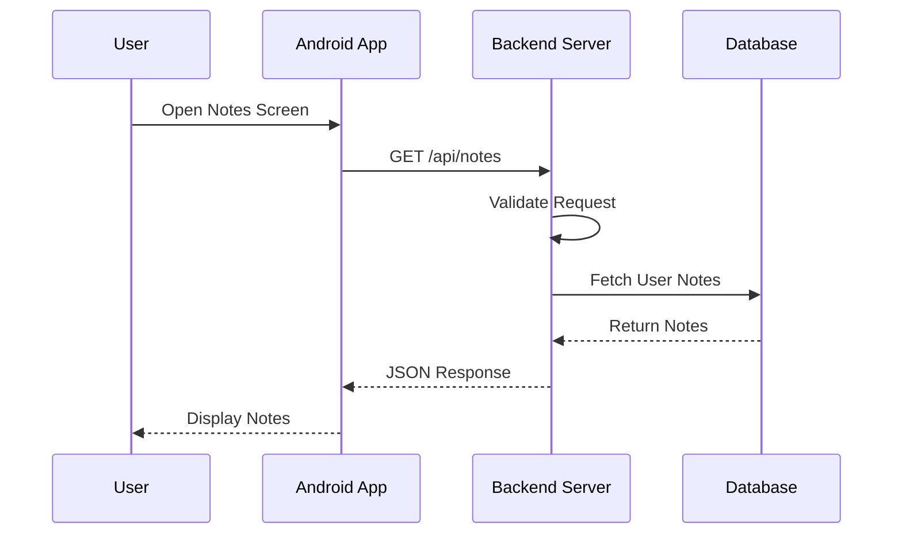
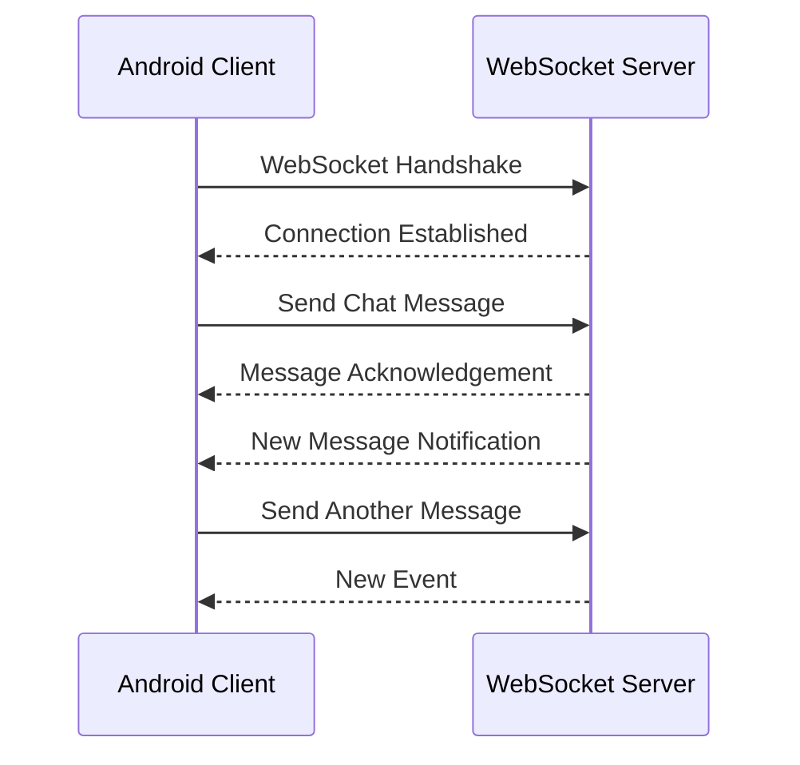
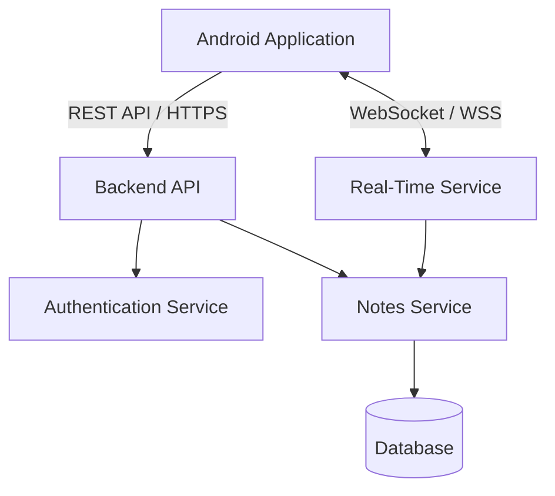

# Week 1 – Day 3: Client-Server Architecture, REST APIs and WebSockets

Week 1Day 3Beginner level

File name: `Day-3-Client-Server-and-APIs.md`

Today's topics:

1. What is client-server architecture?
2. What is a client?
3. What is a server?
4. How does client-server communication work?
5. What is a request-response lifecycle?
6. What is HTTP and HTTPS?
7. What is an API?
8. What is REST API?
9. HTTP methods – GET, POST, PUT, PATCH and DELETE.
10. HTTP status codes.
11. What is JSON?
12. What are WebSockets?
13. REST API vs WebSockets.
14. Practical Notes application architecture.
15. Interview questions and answers.

Why is Day 3 important?

As an Android developer, you probably use Retrofit, OkHttp, REST APIs and JSON regularly.

But in system design interviews, knowing how to call an API is not enough. You must understand what happens behind the API, how clients communicate with servers, how requests are processed and when different communication mechanisms should be used.

Let's start from zero.

Writing

# Day 3 – Client-Server Architecture, REST APIs and WebSockets

**Week:** 1 – System Design Basics\
**Level:** Beginner\
**Previous topic:** Day 2 – System Quality Attributes\
**Example used throughout:** Notes Application

---

# 1\. Introduction to Client-Server Architecture

## 1.1 First, Understand the Problem

Imagine you are using a Notes application on your Android phone.

You create a note:

- Title: Shopping List
- Description: Buy milk, bread and eggs.

You click the Save button.

Now think about these questions:

1. Where will the note be stored?
2. How will the application save the note?
3. If you open the same account on another phone, how will that phone get your note?
4. How does your Android application communicate with the backend?
5. Who processes the request?

To answer these questions, we need to understand client-server architecture.

## 1.2 What is Client-Server Architecture?

Client-server architecture is a software architecture in which two major components communicate with each other:

1. Client.
2. Server.

The client sends requests to the server.

The server processes those requests and sends responses back to the client.

### Simple definition

Client-server architecture is a model in which a client requests services or resources from a server, and the server processes the request and provides a response.

### Real-world example

Imagine ordering food at a restaurant.

- You are the customer.
- The waiter takes your order.
- The kitchen prepares the food.
- The waiter brings the food back to you.

Similarly:

- Client = Customer.
- Server = Service provider.
- Request = Order.
- Response = Food delivered.

The client requests something, and the server provides the requested result.

---

# 2\. What is a Client?

## 2.1 Definition

A client is an application or device that requests data or services from another system, usually a server.

Examples of clients:

- Android application.
- iOS application.
- Web browser.
- Desktop application.
- Smartwatch application.

In our Notes application, the Android application is the client.

### Responsibilities of a Client

1. Display the user interface.
2. Collect user input.
3. Send requests to the server.
4. Receive server responses.
5. Display the returned information.
6. Handle loading and error states.
7. Manage local data when required.

### Android example

Consider this Retrofit API:

kotlin

```kotlin
interface NotesApi {

    @GET("notes")
    suspend fun getNotes(): List<Note>
}
```

The Android application calls this API to request notes from the backend.

Here, the Android application acts as the client.

---

# 3\. What is a Server?

## 3.1 Definition

A server is a computer or software application that receives requests from clients, processes them and returns responses.

A server usually runs continuously and waits for incoming requests.

In our Notes application, the backend server handles operations such as:

- User authentication.
- Creating notes.
- Updating notes.
- Deleting notes.
- Searching notes.
- Retrieving notes.

### Responsibilities of a Server

1. Receive client requests.
2. Validate incoming data.
3. Authenticate users.
4. Check authorization.
5. Execute business logic.
6. Communicate with databases.
7. Return appropriate responses.

### Example

Suppose Android sends this request:

http

```http
GET /notes
```

The backend server:

1. Receives the request.
2. Checks whether the user is authenticated.
3. Retrieves the user's notes from the database.
4. Converts the result into a response.
5. Sends the response to Android.

---

# 4\. How Client-Server Communication Works

Let's understand the complete flow.

Imagine the user opens the Notes screen.

The Android application needs to display all saved notes.

### Step-by-step flow

**Step 1: User action**

The user opens the Notes screen.

**Step 2: Android sends a request**

The Android application sends an HTTP request to the backend.

Example:

http

```http
GET /api/notes
```

**Step 3: Server receives the request**

The backend receives the request and identifies the requested operation.

**Step 4: Server validates the request**

The backend checks:

- Is the request valid?
- Is the user authenticated?
- Is the user allowed to access these notes?

**Step 5: Server communicates with the database**

The backend retrieves the notes belonging to the user.

**Step 6: Server creates a response**

The backend converts the result into JSON.

**Step 7: Server sends the response**

The response travels back to Android.

**Step 8: Android updates the UI**

The Android application displays the notes.

### Architecture diagram

mermaid



This is the basic client-server request-response model.

---

# 5\. What is a Network?

Before understanding HTTP, we need to understand a network.

A network is a collection of connected devices that can communicate and exchange information.

For example:

- Your Android phone.
- Your home Wi-Fi router.
- Internet infrastructure.
- A cloud server.

These devices communicate through networking protocols.

A protocol is a set of rules that defines how devices communicate.

Examples:

- TCP.
- IP.
- HTTP.
- HTTPS.
- WebSocket.

When your Android application communicates with a backend, the request travels through a network.

---

# 6\. What is HTTP?

## 6.1 Definition

HTTP stands for Hypertext Transfer Protocol.

HTTP is an application-layer protocol used for communication between clients and servers.

It defines how requests and responses should be structured.

For example:

Your Android application wants to retrieve notes.

It sends an HTTP request to the backend.

The backend sends an HTTP response.

HTTP commonly follows a request-response communication model.

## 6.2 HTTP Request

An HTTP request contains information about what the client wants the server to do.

A request commonly contains:

1. HTTP method.
2. URL or path.
3. Headers.
4. Optional request body.

Example:

http

```http
GET /api/notes HTTP/1.1
Host: example.com
Authorization: Bearer access_token
Accept: application/json
```

Let's understand each part.

### HTTP Method

Specifies the operation the client wants to perform.

Examples:

- GET.
- POST.
- PUT.
- PATCH.
- DELETE.

### URL

Specifies the resource or endpoint being requested.

Example:

text

```text
https://example.com/api/notes
```

### Headers

Headers provide additional information about the request.

Examples:

http

```http
Authorization: Bearer access_token
Content-Type: application/json
Accept: application/json
```

Authorization contains credentials used by the server to identify or authorize the request.

Content-Type describes the format of the request body.

Accept describes the response formats the client can accept.

### Request Body

The request body contains data sent to the server.

Example:

json

```json
{
  "title": "Shopping List",
  "description": "Buy milk and bread"
}
```

A GET request usually does not need a request body.

A POST request commonly includes one.

---

# 7\. HTTP Response

## 7.1 Definition

An HTTP response is the information returned by the server after processing a request.

An HTTP response commonly contains:

1. Status code.
2. Headers.
3. Response body.

Example:

http

```http
HTTP/1.1 200 OK
Content-Type: application/json
```

Response body:

json

```json
{
  "id": "101",
  "title": "Shopping List",
  "description": "Buy milk and bread"
}
```

### Status Code

The status code tells the client whether the request succeeded or encountered a problem.

### Response Headers

These contain additional information about the response.

### Response Body

Contains the actual data returned by the server.

---

# 8\. What is HTTPS?

## 8.1 Definition

HTTPS stands for Hypertext Transfer Protocol Secure.

HTTPS is HTTP communication protected using TLS (Transport Layer Security).

TLS provides encryption and helps authenticate the server.

In simple words:

HTTP communicates without TLS protection.

HTTPS protects HTTP communication using TLS.

### Why do we need HTTPS?

Imagine a user logs into your Notes application.

The Android application sends login information to the backend.

Without secure transport, sensitive information could be exposed to attackers who can intercept the communication.

HTTPS helps protect information during transmission.

### HTTP vs HTTPS

| HTTP | HTTPS |
| --- | --- |
| HTTP communication without TLS | HTTP protected by TLS |
| No TLS encryption | Encrypted communication |
| Does not provide TLS server authentication | Provides TLS server authentication |
| Default port 80 | Default port 443 |
| Not suitable for transmitting sensitive information without additional protection | Standard choice for secure API communication |

**Interview point:** Modern mobile applications should use HTTPS for backend communication.

---

# 9\. What is an API?

## 9.1 Definition

API stands for Application Programming Interface.

An API is a defined interface that allows two software components to communicate with each other.

In simple words:

An API defines how one software component can request functionality or data from another component.

### Real-world example

Imagine you are using an ATM.

You select:

- Check balance.
- Withdraw money.
- Deposit money.

You don't directly interact with the bank's internal database.

You interact with the ATM interface.

The ATM communicates with the banking system to perform the requested operation.

Similarly, an Android application uses APIs to communicate with the backend.

### Android example

kotlin

```kotlin
interface NotesApi {

    @GET("notes")
    suspend fun getNotes(): List<Note>

    @POST("notes")
    suspend fun createNote(
        @Body note: CreateNoteRequest
    ): Note

    @DELETE("notes/{id}")
    suspend fun deleteNote(
        @Path("id") id: String
    )
}
```

This interface defines how the Android application communicates with the Notes backend.

### Why do we need APIs?

1. Allow different applications to communicate.
2. Hide internal implementation details.
3. Provide controlled access to backend functionality.
4. Enable data exchange between systems.
5. Help separate client and server responsibilities.

For example, Android and iOS applications can use the same backend APIs.

They don't need separate business logic implementations on the backend.

---

# 10\. What is REST API?

## 10.1 First, Understand REST

REST stands for Representational State Transfer.

REST is an architectural style for designing network-based APIs.

It provides guidelines for how clients and servers should communicate and manage resources.

A REST-style API commonly uses:

- HTTP.
- Resources.
- URLs.
- HTTP methods.
- Standard status codes.
- Representations such as JSON.

## 10.2 What is a Resource?

A resource is an identifiable object or collection of objects managed by an API.

Examples in a Notes application:

- Users.
- Notes.
- Comments.
- Attachments.

Each resource is typically identified by a URL.

Example:

text

```text
/api/notes
/api/notes/101
/api/users
/api/users/25
```

Here:

`/api/notes` represents the collection of notes.

`/api/notes/101` represents an individual note.

## 10.3 REST API Example

Imagine our Notes application supports four operations.

### 1\. Get all notes

http

```http
GET /api/notes
```

Purpose:

Retrieve the user's notes.

### 2\. Create a note

http

```http
POST /api/notes
```

Request body:

json

```json
{
  "title": "Shopping List",
  "description": "Buy milk and bread"
}
```

Purpose:

Create a new note.

### 3\. Update a note

http

```http
PUT /api/notes/101
```

Request body:

json

```json
{
  "title": "Updated Shopping List",
  "description": "Buy milk, bread and eggs"
}
```

Purpose:

Replace the represented note with the supplied updated representation.

### 4\. Delete a note

http

```http
DELETE /api/notes/101
```

Purpose:

Delete the note with ID 101.

---

# 11\. HTTP Methods in REST APIs

HTTP methods define the intended operation on a resource.

The most commonly used methods are GET, POST, PUT, PATCH and DELETE.

## 11.1 GET

GET is used to retrieve information.

Example:

http

```http
GET /api/notes
```

This requests a collection of notes.

Another example:

http

```http
GET /api/notes/101
```

This requests one particular note.

Important characteristics:

- Used for reading data.
- Should not intentionally modify server state.
- Safe and idempotent according to HTTP semantics.

## 11.2 POST

POST is commonly used to create a resource or perform an operation.

Example:

http

```http
POST /api/notes
```

Request:

json

```json
{
  "title": "Meeting Notes",
  "description": "Discuss project progress"
}
```

The server creates a new note.

Important characteristics:

- Commonly used to create resources.
- May modify server state.
- Not necessarily idempotent.

## 11.3 PUT

PUT is used to create or replace the state of a resource at a known target URI, depending on the API design.

Example:

http

```http
PUT /api/notes/101
```

Request:

json

```json
{
  "title": "Meeting Notes",
  "description": "Discuss project progress and deadlines"
}
```

The API replaces the represented note with the supplied representation.

Important characteristic:

PUT is idempotent.

## 11.4 PATCH

PATCH is used to apply partial modifications to a resource.

Example:

http

```http
PATCH /api/notes/101
```

Request:

json

```json
{
  "title": "Updated Meeting Notes"
}
```

Only the title is modified.

The other fields remain unchanged, assuming the API defines partial update behavior this way.

PATCH is not automatically idempotent; that depends on the patch operation.

## 11.5 DELETE

DELETE is used to remove a resource.

Example:

http

```http
DELETE /api/notes/101
```

The server processes the deletion of note 101.

DELETE is defined as idempotent in HTTP semantics, although repeated responses need not be identical.

## 11.6 HTTP Methods Comparison

| Method | Purpose | Example |
| --- | --- | --- |
| GET | Retrieve resource | Get notes |
| POST | Create or process operation | Create note |
| PUT | Replace resource | Replace note |
| PATCH | Partially update resource | Update title |
| DELETE | Remove resource | Delete note |

---

# 12\. Important HTTP Concepts: Safe and Idempotent

These concepts are often asked in interviews.

## 12.1 What is an Idempotent Operation?

An operation is idempotent if performing the same operation multiple times has the same intended effect on the server state as performing it once.

Example:

http

```http
PUT /api/notes/101
```

Suppose the request updates note 101 to:

json

```json
{
  "title": "Shopping List"
}
```

Sending the same PUT request multiple times should leave the note in the same intended state.

The request does not keep creating additional copies of the note.

## 12.2 What is a Safe Method?

A safe HTTP method is intended to retrieve information without requesting a change to server state.

GET is a safe method.

For example:

http

```http
GET /api/notes
```

It retrieves notes without intentionally modifying them.

## 12.3 Safe and Idempotent Methods

| Method | Safe? | Idempotent? |
| --- | --- | --- |
| GET | Yes | Yes |
| POST | No | Not necessarily |
| PUT | No | Yes |
| PATCH | No | Not necessarily |
| DELETE | No | Yes |

Why is this important?

Imagine your Android application sends a create-note request.

The server successfully creates the note, but the response gets lost due to a network failure.

Android does not know whether the operation succeeded.

If it blindly retries the POST request, the server may create a duplicate note.

This is why retry handling and idempotency are important in distributed systems.

One solution is to use an idempotency key for operations that need safe retry behavior, provided the backend supports it.

We will revisit this in future system design topics.

---

# 13\. HTTP Status Codes

HTTP status codes tell clients the result of an HTTP request.

They are grouped into five categories.

## 13.1 1xx – Informational

These indicate that the request has been received and processing is continuing.

Example:

100 Continue.

These are not commonly handled directly in everyday Android API development.

## 13.2 2xx – Success

These indicate that the request was successfully received, understood and processed.

Common codes:

| Code | Meaning | Example |
| --- | --- | --- |
| 200 | OK | Notes retrieved successfully |
| 201 | Created | Note created successfully |
| 202 | Accepted | Request accepted for asynchronous processing |
| 204 | No Content | Delete completed without a response body |

## 13.3 3xx – Redirection

These indicate that further action is needed to complete the request.

Examples:

| Code | Meaning |
| --- | --- |
| 301 | Moved Permanently |
| 302 | Found |
| 304 | Not Modified |

304 is useful in HTTP caching scenarios.

## 13.4 4xx – Client Errors

These indicate that there is a problem with the request or the client's authorization.

Common codes:

| Code | Meaning | Example |
| --- | --- | --- |
| 400 | Bad Request | Invalid request body |
| 401 | Unauthorized | Missing or invalid authentication |
| 403 | Forbidden | User is not allowed to access the resource |
| 404 | Not Found | Requested note does not exist |
| 409 | Conflict | Request conflicts with current resource state |
| 429 | Too Many Requests | Rate limit exceeded |

Important difference:

401 means valid authentication credentials are missing or not accepted.

403 means the server understood the request but refuses to authorize it.

## 13.5 5xx – Server Errors

These indicate that the server failed to fulfill a valid request.

| Code | Meaning |
| --- | --- |
| 500 | Internal Server Error |
| 501 | Not Implemented |
| 502 | Bad Gateway |
| 503 | Service Unavailable |
| 504 | Gateway Timeout |

Example:

If the Notes backend encounters an unexpected error while processing a request, it may return 500.

If a gateway cannot receive a timely response from an upstream server, it may return 504.

---

# 14\. What is JSON?

## 14.1 Definition

JSON stands for JavaScript Object Notation.

JSON is a lightweight text-based data format used to exchange structured information between systems.

REST APIs commonly use JSON for request and response bodies.

## 14.2 Example

Suppose our Notes application needs to receive a note from the backend.

JSON response:

json

```json
{
  "id": "101",
  "title": "Shopping List",
  "description": "Buy milk and bread",
  "createdAt": 1793400000
}
```

This JSON contains four fields:

- id.
- title.
- description.
- createdAt.

## 14.3 JSON Data Types

JSON supports:

### String

json

```json
{
  "title": "Shopping List"
}
```

### Number

json

```json
{
  "age": 25
}
```

### Boolean

json

```json
{
  "isPinned": true
}
```

### Array

json

```json
{
  "tags": ["Personal", "Shopping", "Important"]
}
```

### Object

json

```json
{
  "user": {
    "id": 10,
    "name": "John"
  }
}
```

### Null

json

```json
{
  "description": null
}
```

## 14.4 JSON and Kotlin Data Classes

As an Android developer, you probably use Gson, Moshi or Kotlin Serialization.

Consider this JSON:

json

```json
{
  "id": "101",
  "title": "Shopping List",
  "isPinned": true
}
```

Corresponding Kotlin model:

kotlin

```kotlin
data class Note(
    val id: String,
    val title: String,
    val isPinned: Boolean
)
```

A serialization library converts JSON into Kotlin objects.

A deserialization library converts Kotlin objects into JSON.

---

# 15\. What is a RESTful API?

A RESTful API is an API designed according to REST architectural constraints.

Common REST principles include:

## 15.1 Client-Server Separation

Client and server responsibilities should be separated.

The client handles the user interface.

The server handles backend operations and data management.

Both can evolve independently as long as their API contract remains compatible.

## 15.2 Statelessness

Statelessness means each request should contain the information needed by the server to understand and process that request.

The server should not depend on hidden conversational session state from a previous request to interpret the current request.

Example:

http

```http
GET /api/notes
Authorization: Bearer access_token
```

The authentication information is supplied with the request.

The backend validates the token rather than relying on an in-memory session created by a previous API call.

Important:

Statelessness does not mean the server cannot store data.

The server absolutely can store user information, notes and other application data in a database.

It means the API request handling does not depend on client session state being stored between requests.

## 15.3 Cacheability

Responses should indicate whether they can be cached and under what conditions.

Caching can reduce repeated requests and improve performance.

Example:

A public profile image may be cacheable for a certain period.

Sensitive note data may require more restrictive caching policies.

We will study caching in detail later.

## 15.4 Uniform Interface

The API should provide a consistent way to identify and interact with resources.

For example:

text

```text
GET    /api/notes
POST   /api/notes
GET    /api/notes/101
PUT    /api/notes/101
PATCH  /api/notes/101
DELETE /api/notes/101
```

## 15.5 Layered System

A client may communicate with an intermediary such as an API gateway or proxy rather than directly interacting with the final backend service.

The client does not necessarily need to know all internal infrastructure details.

---

# 16\. What is WebSocket?

Until now, we have discussed HTTP request-response communication.

But imagine a different requirement.

You are developing a chat application.

User A sends a message to User B.

User B should receive the message immediately, even if they are not currently requesting messages from the server.

How can this work?

One approach is for the client to repeatedly request new messages using HTTP polling.

However, continuously sending requests can be inefficient.

A different approach is WebSocket.

## 16.1 Definition

WebSocket is a communication protocol that provides a persistent, full-duplex communication channel between a client and a server over a single connection.

Let's understand the important words.

### Persistent Connection

The connection remains open after it is established, until one side closes it or the connection fails.

### Full-Duplex Communication

Both client and server can send messages to each other independently over the same connection.

For example:

- Android sends a chat message.
- Server sends a new message notification.
- Android sends another message.
- Server sends another update.

Both sides can communicate without creating a new HTTP request for every message.

## 16.2 How Does WebSocket Work?

WebSocket communication usually starts with an HTTP-based handshake.

The client requests an upgrade from HTTP to WebSocket.

If the server accepts, the connection is upgraded.

After that, both sides communicate through WebSocket frames.

Example flow:

mermaid



## 16.3 WebSocket Example: Chat Application

Imagine two users:

- User A.
- User B.

User A sends:

"Hello\!"

The server receives the message and forwards it to User B's active WebSocket connection.

User B receives the message without repeatedly requesting the server for new messages.

This is useful for real-time communication.

## 16.4 Where Are WebSockets Used?

Common use cases:

1. Chat applications.
2. Real-time collaboration.
3. Live dashboards.
4. Multiplayer games.
5. Live notifications.
6. Real-time tracking.
7. Collaborative document editing.

## 16.5 WebSocket in Android

Android applications can use libraries such as OkHttp to create WebSocket connections.

Example:

kotlin

```kotlin
val client = OkHttpClient()

val request = Request.Builder()
    .url("wss://example.com/chat")
    .build()

val webSocket = client.newWebSocket(
    request,
    object : WebSocketListener() {

        override fun onOpen(
            webSocket: WebSocket,
            response: Response
        ) {
            // Connection established
        }

        override fun onMessage(
            webSocket: WebSocket,
            text: String
        ) {
            // Receive message
        }

        override fun onFailure(
            webSocket: WebSocket,
            t: Throwable,
            response: Response?
        ) {
            // Handle failure
        }
    }
)
```

Here:

- `ws://` represents a WebSocket connection.
- `wss://` represents a WebSocket connection protected by TLS.

Note: A real Android implementation must also consider connection lifecycle, reconnection, authentication, background restrictions and resource cleanup.

---

# 17\. REST API vs WebSocket

This is a very important system design interview question.

Let's compare them.

| Category | REST API | WebSocket |
| --- | --- | --- |
| Communication | Request-response | Full-duplex |
| Connection | Typically separate HTTP requests | Persistent connection |
| Direction | Client initiates each request | Both sides can send messages |
| Server-initiated updates | Usually require polling, push or another mechanism | Supported over the open connection |
| Best suited for | Standard data operations | Real-time communication |
| Examples | Create note, fetch profile | Chat messages, live updates |

## 17.1 When Should We Use REST?

Use REST when the client needs to perform standard operations.

Examples:

- Login.
- Fetch notes.
- Create notes.
- Update notes.
- Delete notes.
- Search notes.
- Fetch user profile.

## 17.2 When Should We Use WebSocket?

Use WebSocket when the application needs continuous, two-way communication.

Examples:

- Chat applications.
- Live collaboration.
- Real-time dashboards.
- Multiplayer games.

## 17.3 Can We Use REST and WebSocket Together?

Yes.

Many real-world applications use both.

Example: A collaborative Notes application.

REST APIs:

- Login.
- Create a note.
- Fetch notes.
- Delete notes.
- Fetch user profile.

WebSocket:

- Notify other users when a note changes.
- Send live collaboration events.
- Show real-time editing updates.

This is a practical architecture decision.

---

# 18\. What is Polling?

Polling is a technique in which a client periodically sends requests to a server to check whether new information is available.

Example:

A chat application sends a request every 5 seconds.

text

```text
10:00:00 - GET /messages
10:00:05 - GET /messages
10:00:10 - GET /messages
10:00:15 - GET /messages
```

The client repeatedly checks for new messages.

## 18.1 Short Polling

In short polling, the client sends requests at fixed intervals.

Example:

- Request every 5 seconds.
- Receive available updates.
- Wait 5 seconds.
- Send another request.

Disadvantage:

Many requests may return no new data.

This wastes network and server resources.

## 18.2 Long Polling

In long polling, the client sends a request and the server keeps the request open until new data becomes available or a timeout occurs.

After receiving a response, the client sends another request.

This reduces some unnecessary empty responses compared with short polling.

However, it still involves repeated HTTP requests.

## 18.3 Polling vs WebSocket

| Short Polling | Long Polling | WebSocket |
| --- | --- | --- |
| Repeated requests at intervals | Request waits for an event or timeout | Persistent connection |
| More unnecessary requests possible | Fewer unnecessary empty responses | Supports continuous messaging |
| Simple to implement | More complex than short polling | Requires connection management |
| Updates may be delayed by polling interval | Updates can arrive when the held request completes | Updates can be sent immediately over an open connection |

---

# 19\. Complete Notes Application Architecture

Let's combine today's concepts.

We are designing a cloud-based Notes application.

Requirements:

- Users can log in.
- Users can create notes.
- Users can edit notes.
- Users can delete notes.
- Users can retrieve notes.
- Users can synchronize updates across devices.

We can use:

- Android application as client.
- REST APIs for normal CRUD operations.
- Backend server for business logic.
- Authentication service for user verification.
- Database for persistent storage.
- WebSocket for real-time update notifications, if required.

Architecture:

mermaid



Explanation:

1. The user opens the Android application.
2. The application communicates with the backend using REST APIs.
3. The backend authenticates the user.
4. The Notes Service processes create, update and delete operations.
5. Notes are stored in the database.
6. When real-time updates are required, the Real-Time Service sends events through WebSocket connections.
7. Other connected clients receive the updates.

Important:

We don't need WebSockets for every application.

If the Notes application only needs normal create, read, update and delete operations, REST APIs may be sufficient.

We introduce WebSockets only when the product requirements justify real-time communication.

---

# 20\. Common Interview Questions and Answers

## Q1. What is client-server architecture?

Client-server architecture is a model where clients send requests to servers, and servers process those requests and return responses.

For example, an Android application requests notes from a backend server.

## Q2. What is the difference between a client and a server?

A client requests data or services.

A server receives those requests, processes them and returns responses.

An Android application is an example of a client.

A backend application is an example of a server.

## Q3. What is HTTP?

HTTP is an application-layer protocol used for communication between clients and servers through structured requests and responses.

## Q4. What is HTTPS?

HTTPS is HTTP protected using TLS.

It provides encrypted communication and helps authenticate the server.

## Q5. What is an API?

An API is a defined interface that allows different software components to communicate and exchange information.

## Q6. What is REST API?

REST API is an API designed according to REST architectural principles.

It commonly uses HTTP methods and resource-based URLs to perform operations on resources.

## Q7. What is the difference between PUT and PATCH?

PUT is used to replace the state of a resource.

PATCH is used to apply partial modifications to a resource.

For example, PUT may replace the complete note representation, while PATCH may update only its title.

## Q8. What is the difference between POST and PUT?

POST is commonly used to create resources or process operations.

PUT is used to create or replace a resource at a known URI.

PUT is idempotent, while POST is not necessarily idempotent.

## Q9. What is idempotency?

An operation is idempotent if repeating the same request has the same intended effect on server state as performing it once.

For example, sending the same PUT request multiple times should leave the resource in the same intended state.

## Q10. What is statelessness in REST?

Statelessness means each request contains the information required to process it.

The server does not rely on hidden client session context stored from previous requests to interpret the current request.

The server can still store persistent application data.

## Q11. What is WebSocket?

WebSocket is a protocol that establishes a persistent, full-duplex communication channel between a client and a server.

It is useful for applications requiring real-time communication.

## Q12. What is the difference between REST and WebSocket?

REST typically uses a request-response model where clients initiate requests.

WebSocket provides a persistent, full-duplex channel where both client and server can send messages independently.

REST is commonly used for standard API operations.

WebSocket is useful for chat, live updates and real-time collaboration.

## Q13. Can REST and WebSocket be used in the same application?

Yes.

For example, a Notes application can use REST for creating and retrieving notes and WebSocket for notifying connected devices about live updates.

## Q14. What is polling?

Polling is a technique where the client periodically sends requests to the server to check whether new information is available.

## Q15. What is the difference between short polling and long polling?

Short polling sends requests at fixed intervals.

Long polling keeps a request open until new data is available or a timeout occurs.

---

# 21\. Day 3 Revision Notes

| Concept | Remember |
| --- | --- |
| Client | Application requesting services |
| Server | Application processing client requests |
| HTTP | Protocol for request-response communication |
| HTTPS | HTTP protected using TLS |
| API | Interface for software communication |
| REST | Architectural style for network APIs |
| GET | Retrieve information |
| POST | Create or process an operation |
| PUT | Replace resource |
| PATCH | Partially modify resource |
| DELETE | Delete resource |
| JSON | Lightweight data exchange format |
| WebSocket | Persistent full-duplex communication |
| Polling | Repeatedly check server for updates |
| Statelessness | Each request carries necessary processing context |
| Idempotency | Repeated operation has the same intended effect on server state |

## Important Things to Remember

1. Android is a client in a client-server architecture.
2. The backend receives requests and processes business logic.
3. HTTP uses a request-response model.
4. HTTPS protects HTTP communication using TLS.
5. REST APIs commonly use HTTP methods and resource-based URLs.
6. GET is used to retrieve information.
7. POST is commonly used to create resources.
8. PUT replaces a resource representation.
9. PATCH partially updates a resource.
10. WebSockets support persistent, two-way communication.
11. REST and WebSocket can coexist in one application.
12. Statelessness does not mean the backend cannot store data.

---

# 22\. Day 3 Self-Assessment

Try answering without referring to the notes.

## Basic Understanding

1. What is client-server architecture?
2. What is the difference between a client and a server?
3. What is HTTP?
4. What is HTTPS?
5. What is an API?
6. What is REST API?
7. What is JSON?

## Intermediate Understanding

8. Explain the complete request-response lifecycle.
9. What are HTTP headers?
10. What is the difference between PUT and PATCH?
11. What is idempotency?
12. What is statelessness in REST?
13. What are HTTP status codes?
14. What is the difference between 401 and 403?
15. What is the difference between 500 and 503?

## Advanced Beginner Understanding

16. What is WebSocket?
17. Why do chat applications use WebSockets?
18. What is the difference between REST and WebSocket?
19. What is polling?
20. What is the difference between short polling and long polling?
21. Can REST and WebSocket be used together?
22. Would you use WebSocket for a simple Notes application? Explain your decision.

## Practical Android Questions

23. When you call a Retrofit API, who is the client and who is the server?
24. What happens after Android sends a GET request?
25. Why should Android applications use HTTPS?
26. How would you handle a 401 response?
27. How would you design API communication for a chat application?

---

# 23\. What You Should Be Able to Explain After Day 3

By the end of this lesson, you should be able to:

- Explain client-server architecture from scratch.
- Describe how Android communicates with a backend.
- Explain the HTTP request-response lifecycle.
- Differentiate HTTP and HTTPS.
- Explain APIs and REST.
- Understand GET, POST, PUT, PATCH and DELETE.
- Explain common HTTP status codes.
- Understand JSON request and response bodies.
- Explain REST statelessness and idempotency.
- Explain WebSockets.
- Decide when to use REST APIs and when to use WebSockets.
- Draw a basic client-server architecture for a Notes application.

**End of Day 3 – Client-Server Architecture, REST APIs and WebSockets**

**Next: Day 4 – Database Fundamentals: SQL vs NoSQL, Relational Databases, Document Databases, Data Modelling and Database Selection.**

## How to study Day 3

I recommend spending extra time on these three areas:

1. Request-response lifecycle: Understand exactly what happens when Retrofit calls an API.
2. REST methods: Understand why GET, POST, PUT, PATCH and DELETE are different.
3. REST vs WebSocket: Be able to explain when you would choose each one in a real application.

These three topics are particularly useful when interviewers ask you to design a mobile application with a backend.
