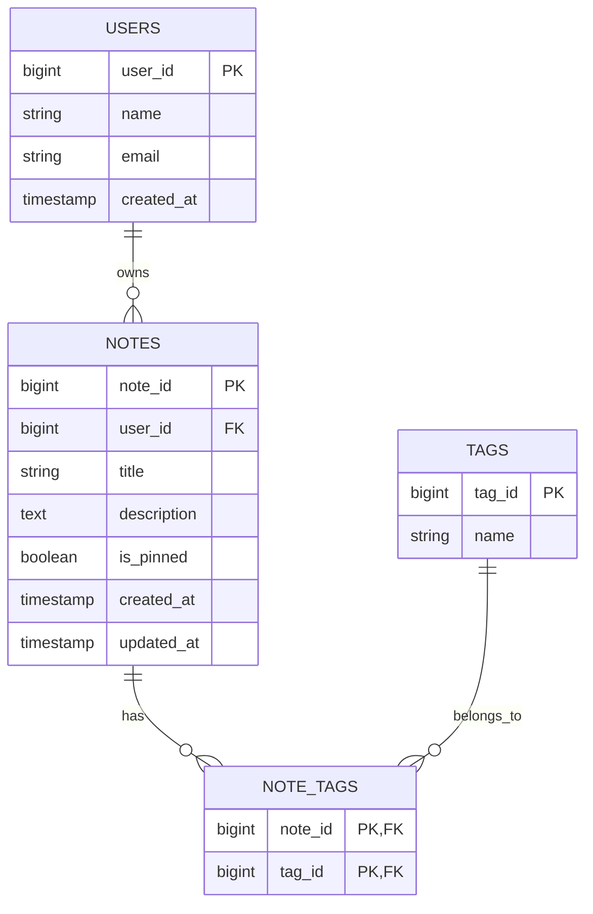

# Week 1 – Day 4: Database Fundamentals – SQL vs NoSQL

Week 1Day 4Beginner level

File name: `Day-4-Database-Fundamentals-SQL-vs-NoSQL.md`

Today's topics:

1. What is a database?
2. Why do we need a database?
3. What is DBMS?
4. What is RDBMS?
5. What is SQL?
6. Tables, rows and columns.
7. Primary key and foreign key.
8. Relationships between tables.
9. SQL vs NoSQL.
10. Types of NoSQL databases.
11. ACID properties.
12. Database indexing.
13. Database replication.
14. Database sharding.
15. How to choose SQL or NoSQL.
16. Notes application database design.
17. Interview questions and answers.

Why is Day 4 important?

As an Android developer, you probably work with Room, SQLite, Firebase or APIs that return database records.

But in system design interviews, you need to understand more than how to store data.

You should be able to answer:

- Where should application data be stored?
- Should we use SQL or NoSQL?
- How should we design database tables?
- How do we connect users and notes?
- What happens when millions of records are stored?
- How do we retrieve data efficiently?

Let's understand everything from scratch.

Writing

# Day 4 – Database Fundamentals: SQL vs NoSQL

**Week:** 1 – System Design Basics\
**Level:** Beginner\
**Previous topic:** Day 3 – Client-Server Architecture, REST APIs and WebSockets\
**Example used throughout:** Notes Application

---

# 1\. What is a Database?

## 1.1 First, Understand the Problem

Imagine you are developing a Notes application.

A user creates three notes:

1. Shopping List.
2. Meeting Notes.
3. Personal Diary.

Where should you store these notes?

One option is to keep them inside application memory.

But there is a problem.

When the application closes, its in-memory data disappears.

We need a permanent place to store information.

That is where a database comes in.

## 1.2 Definition

A database is an organized collection of data that can be stored, accessed, managed and updated.

In simple words:

**A database is a place where an application stores information so that it can retrieve and use it later.**

Examples of data stored in databases:

- User information.
- Notes.
- Messages.
- Orders.
- Payments.
- Product details.
- Comments.

## 1.3 Real-World Example

Imagine a school.

The school maintains information about students:

| Student ID | Name | Age | Class |
| --- | --- | --- | --- |
| 101 | Rahul | 20 | A |
| 102 | Priya | 21 | B |
| 103 | Amit | 19 | A |

Instead of writing this information on separate pieces of paper, the school stores it in an organized system.

A database works similarly.

It stores information in a structured or otherwise organized format.

## 1.4 Why Do We Need a Database?

Without a database:

- Data may disappear when an application closes.
- Managing large amounts of information becomes difficult.
- Searching information becomes inefficient.
- Updating records becomes complicated.
- Multiple users cannot easily share the same information.
- Maintaining data consistency becomes difficult.

A database helps us:

1. Store information permanently.
2. Retrieve information when needed.
3. Update existing information.
4. Delete unwanted information.
5. Search information efficiently.
6. Manage data for multiple users.
7. Protect data through access control and other mechanisms.

---

# 2\. What is DBMS?

## 2.1 Definition

DBMS stands for Database Management System.

A DBMS is software that allows applications or users to create, store, retrieve, update and manage data in a database.

In simple words:

The database is where data is stored.

The DBMS is the software that helps us manage that data.

## 2.2 Real-World Example

Imagine a library.

- Books are the stored information.
- The librarian manages the books.
- Readers request books.
- The librarian finds and provides the requested books.

Similarly:

- Database = Stored data.
- DBMS = Software managing the data.
- Application = Client requesting information.

## 2.3 Examples of DBMS

Some popular database management systems:

| DBMS | Type |
| --- | --- |
| MySQL | Relational |
| PostgreSQL | Relational |
| Oracle Database | Relational |
| Microsoft SQL Server | Relational |
| MongoDB | Document-oriented |
| Redis | Key-value |
| Cassandra | Wide-column |
| SQLite | Relational |

Important:

SQLite is commonly used in Android applications through libraries such as Room.

---

# 3\. What is RDBMS?

## 3.1 Definition

RDBMS stands for Relational Database Management System.

An RDBMS is a type of DBMS that stores data in tables consisting of rows and columns.

The tables can be related to each other using keys.

In simple words:

An RDBMS stores data in structured tables and allows relationships between those tables.

Examples:

- MySQL.
- PostgreSQL.
- Oracle Database.
- Microsoft SQL Server.
- SQLite.

## 3.2 Understanding Tables

Imagine our Notes application.

We need to store information about users and their notes.

We can create two tables.

### Users Table

| user\_id | name | email |
| --- | --- | --- |
| 1 | Rahul | rahul@gmail.com |
| 2 | Priya | priya@gmail.com |

### Notes Table

| note\_id | user\_id | title |
| --- | --- | --- |
| 101 | 1 | Shopping List |
| 102 | 1 | Meeting Notes |
| 103 | 2 | Personal Diary |

Let's understand the structure.

### Table

A table is a collection of related records.

Example: Users table.

### Row

A row represents one individual record.

Example:

| user\_id | name | email |
| --- | --- | --- |
| 1 | Rahul | rahul@gmail.com |

This entire entry is one row.

### Column

A column represents a particular attribute of the records.

Examples:

- user\_id.
- name.
- email.

### Diagram

text

```text
             USERS TABLE

     user_id | name  | email
     -----------------------------
        1    | Rahul | rahul@gmail.com
        2    | Priya | priya@gmail.com
        3    | Amit  | amit@gmail.com

     Row = One record
     Column = One attribute
```

---

# 4\. What is SQL?

## 4.1 Definition

SQL stands for Structured Query Language.

SQL is a language used to communicate with relational databases.

We use SQL to:

- Create tables.
- Insert records.
- Retrieve records.
- Update records.
- Delete records.
- Define relationships.
- Manage database permissions.

In simple words:

SQL is the language we use to ask a relational database to perform operations on data.

## 4.2 Basic SQL Operations

Let's understand SQL using our Notes application.

### 1\. CREATE – Create a Table

sql

```sql
CREATE TABLE users (
    user_id INTEGER PRIMARY KEY,
    name VARCHAR(100),
    email VARCHAR(150)
);
```

This creates a table called `users`.

### 2\. INSERT – Add Data

sql

```sql
INSERT INTO users (
    user_id,
    name,
    email
)
VALUES (
    1,
    'Rahul',
    'rahul@gmail.com'
);
```

This inserts one user record.

### 3\. SELECT – Retrieve Data

sql

```sql
SELECT * FROM users;
```

This retrieves all records from the users table.

To retrieve only one column:

sql

```sql
SELECT name FROM users;
```

To retrieve a specific user:

sql

```sql
SELECT *
FROM users
WHERE user_id = 1;
```

### 4\. UPDATE – Modify Data

sql

```sql
UPDATE users
SET name = 'Rahul Kumar'
WHERE user_id = 1;
```

This updates the user's name.

### 5\. DELETE – Remove Data

sql

```sql
DELETE FROM users
WHERE user_id = 1;
```

This deletes the user with ID 1.

## 4.3 CRUD Operations

CRUD represents the four basic operations performed on data.

| Operation | Meaning | SQL |
| --- | --- | --- |
| Create | Add new data | INSERT |
| Read | Retrieve data | SELECT |
| Update | Modify data | UPDATE |
| Delete | Remove data | DELETE |

You will see CRUD operations in almost every application.

For example, our Notes application supports:

- Create note.
- Read note.
- Update note.
- Delete note.

---

# 5\. Primary Key

## 5.1 What is a Primary Key?

A primary key is a column or combination of columns that uniquely identifies each row in a database table.

In simple words:

A primary key is a unique identity for every record.

Example:

Users table:

| user\_id | name |
| --- | --- |
| 1 | Rahul |
| 2 | Priya |
| 3 | Amit |

Here, `user_id` is the primary key.

Why?

Because every user has a unique user ID.

## 5.2 Important Characteristics

1. A primary key must be unique.
2. A primary key cannot contain NULL values.
3. A table has one primary key constraint.
4. The primary key can contain one or multiple columns.

## 5.3 Example

sql

```sql
CREATE TABLE users (
    user_id INTEGER PRIMARY KEY,
    name VARCHAR(100)
);
```

Here, `user_id` uniquely identifies every user.

Why do we need it?

Imagine two users have the same name.

| user\_id | name |
| --- | --- |
| 1 | Rahul |
| 2 | Rahul |

If we search using the name Rahul, we may get two users.

But if we search using user ID 1, we get one specific user.

This is why unique identifiers are important.

---

# 6\. Foreign Key

## 6.1 What is a Foreign Key?

A foreign key is a column or group of columns in one table that references a candidate key, usually the primary key, in another table.

In simple words:

A foreign key creates a relationship between two tables.

## 6.2 Notes Application Example

We have two tables.

### Users Table

| user\_id | name |
| --- | --- |
| 1 | Rahul |
| 2 | Priya |

### Notes Table

| note\_id | user\_id | title |
| --- | --- | --- |
| 101 | 1 | Shopping List |
| 102 | 1 | Meeting Notes |
| 103 | 2 | Personal Diary |

Here:

- `user_id` in Users is the primary key.
- `user_id` in Notes is a foreign key referencing Users.

This tells us which user owns each note.

### SQL Example

sql

```sql
CREATE TABLE users (
    user_id INTEGER PRIMARY KEY,
    name VARCHAR(100)
);

CREATE TABLE notes (
    note_id INTEGER PRIMARY KEY,
    user_id INTEGER,
    title VARCHAR(200),

    FOREIGN KEY (user_id)
    REFERENCES users(user_id)
);
```

## 6.3 Why Do We Need Foreign Keys?

Without foreign keys, it becomes easier to accidentally create inconsistent relationships.

For example:

| note\_id | user\_id | title |
| --- | --- | --- |
| 101 | 999 | Shopping List |

If user 999 does not exist, the note refers to a nonexistent user.

A foreign key constraint can prevent this kind of invalid relationship.

Important:

A foreign key does not automatically guarantee that every application-level authorization rule is satisfied. The backend must still verify that a user is allowed to access or modify a particular note.

---

# 7\. Relationships Between Tables

In relational databases, tables can be connected using relationships.

There are three common types.

## 7.1 One-to-One Relationship

One record in Table A is associated with one record in Table B.

Example:

User and User Profile.

One user has one profile.

text

```text
USERS              USER_PROFILES

user_id             profile_id
  1          ---->       101
  2          ---->       102
```

Example database:

Users:

| user\_id | name |
| --- | --- |
| 1 | Rahul |
| 2 | Priya |

User Profiles:

| profile\_id | user\_id | bio |
| --- | --- | --- |
| 101 | 1 | Android Developer |
| 102 | 2 | Designer |

A unique constraint on `user_id` in User Profiles can enforce this one-to-one relationship.

## 7.2 One-to-Many Relationship

One record in Table A can be associated with multiple records in Table B.

Example:

One user can have many notes.

text

```text
USER 1
  |
  |------ NOTE 101
  |
  |------ NOTE 102
  |
  |------ NOTE 103
```

This is our Notes application relationship.

Users:

| user\_id | name |
| --- | --- |
| 1 | Rahul |

Notes:

| note\_id | user\_id | title |
| --- | --- | --- |
| 101 | 1 | Shopping |
| 102 | 1 | Meeting |
| 103 | 1 | Personal |

The same user ID appears in multiple note records.

## 7.3 Many-to-Many Relationship

Multiple records in Table A can be associated with multiple records in Table B.

Example:

Students and Courses.

- One student can enroll in many courses.
- One course can have many students.

We usually introduce a junction table to represent this relationship.

### Students

| student\_id | name |
| --- | --- |
| 1 | Rahul |
| 2 | Priya |

### Courses

| course\_id | course\_name |
| --- | --- |
| 101 | Android |
| 102 | System Design |

### Student\_Courses

| student\_id | course\_id |
| --- | --- |
| 1 | 101 |
| 1 | 102 |
| 2 | 101 |

The junction table connects students and courses.

### Diagram

text

```text
STUDENTS
   |
   | 1
   |
   v
STUDENT_COURSES
   |
   | Many
   |
   v
COURSES
```

## 7.4 Relationship Summary

| Relationship | Meaning | Example |
| --- | --- | --- |
| One-to-One | One record relates to one record | User and Profile |
| One-to-Many | One record relates to many records | User and Notes |
| Many-to-Many | Many records relate to many records | Students and Courses |

---

# 8\. What is Normalization?

## 8.1 Definition

Normalization is the process of organizing relational database tables to reduce unnecessary data duplication and improve data consistency.

In simple words:

Normalization helps us avoid storing the same information repeatedly when it can be stored separately and connected through relationships.

## 8.2 Understand the Problem

Imagine we store users and notes in one table.

| user\_id | user\_name | note\_id | note\_title |
| --- | --- | --- | --- |
| 1 | Rahul | 101 | Shopping |
| 1 | Rahul | 102 | Meeting |
| 1 | Rahul | 103 | Personal |
| 2 | Priya | 104 | Diary |

Notice something.

Rahul's name is repeated three times.

This creates unnecessary duplication.

If Rahul changes his name, we may need to update multiple rows.

If one row is not updated, the data becomes inconsistent.

## 8.3 Normalized Design

Instead, separate the data into two tables.

Users:

| user\_id | user\_name |
| --- | --- |
| 1 | Rahul |
| 2 | Priya |

Notes:

| note\_id | user\_id | note\_title |
| --- | --- | --- |
| 101 | 1 | Shopping |
| 102 | 1 | Meeting |
| 103 | 1 | Personal |
| 104 | 2 | Diary |

Now the user's name is stored only once.

The Notes table stores the user ID to identify the owner.

This is a simpler and more maintainable design.

## 8.4 Common Normal Forms

You may hear these terms in interviews.

- 1NF – First Normal Form.
- 2NF – Second Normal Form.
- 3NF – Third Normal Form.

For a beginner, understand these at a high level.

### First Normal Form (1NF)

Each column should contain atomic values rather than multiple values packed into one field.

Bad example:

| user\_id | phone\_numbers |
| --- | --- |
| 1 | 9999, 8888 |

Better design:

| user\_id | phone\_number |
| --- | --- |
| 1 | 9999 |
| 1 | 8888 |

### Second Normal Form (2NF)

The table should be in 1NF, and every non-key attribute should depend on the entire candidate key, not just part of a composite key.

This is particularly relevant when a table has a primary key made from multiple columns.

### Third Normal Form (3NF)

The table should be in 2NF, and non-key attributes should not depend transitively on a candidate key.

In simpler terms, non-key information should depend on the key, the whole key and nothing but the key.

## 8.5 Why Do We Need Normalization?

1. Reduce duplicate data.
2. Improve data consistency.
3. Make updates easier.
4. Reduce unnecessary storage.
5. Make data relationships clearer.

Important:

Normalization is not always the only design choice.

In some high-read workloads, denormalization is intentionally used to improve query performance.

We will understand that trade-off in future system design topics.

---

# 9\. What is NoSQL?

## 9.1 First, Understand the Problem

Imagine your Notes application supports only simple text notes.

Every note has:

- ID.
- Title.
- Description.
- Created date.

This is structured data.

A relational database is a natural choice.

Now imagine the application supports many different types of content:

- Text notes.
- Images.
- Audio recordings.
- Checklists.
- Location-based notes.
- Rich document blocks.

The data structures may vary significantly.

We may consider a flexible data model.

This is one situation where a NoSQL database may be useful.

## 9.2 Definition

NoSQL refers to a broad category of database systems that do not rely exclusively on the traditional relational table model.

Many NoSQL databases support flexible schemas and are designed for particular data models and access patterns.

In simple words:

NoSQL databases offer different ways of storing and retrieving data beyond traditional relational tables.

## 9.3 Examples of NoSQL Databases

| Database | Data Model |
| --- | --- |
| MongoDB | Document |
| Redis | Key-value |
| Apache Cassandra | Wide-column |
| Amazon DynamoDB | Key-value and document |
| Neo4j | Graph |

Important:

NoSQL does not mean that the database cannot use structured data.

It means that the database does not follow the traditional relational model as its primary data model.

---

# 10\. Types of NoSQL Databases

There are four commonly discussed categories.

## 10.1 Document Database

A document database stores information as documents, commonly using JSON-like structures.

Example: MongoDB.

Imagine a note document:

json

```json
{
  "_id": "101",
  "userId": "1",
  "title": "Shopping List",
  "description": "Buy milk and bread",
  "tags": [
    "shopping",
    "personal"
  ],
  "isPinned": true
}
```

Each note can be stored as a document.

Documents can have different fields depending on the application's requirements.

For example, an audio note might contain an additional audio URL.

### When is it useful?

- Content management systems.
- Product catalogs.
- Applications with flexible document structures.
- Applications where data is commonly accessed as whole documents.

## 10.2 Key-Value Database

A key-value database stores data as key-value pairs.

Example: Redis.

Imagine:

text

```text
user:101:theme = dark
user:102:theme = light
```

Here:

- Key = `user:101:theme`
- Value = `dark`

Another example:

text

```text
session:abc123 = user101
```

The key identifies the value.

### When is it useful?

- Caching.
- Session management.
- Temporary data.
- Fast key-based lookups.
- Counters and similar operations.

## 10.3 Wide-Column Database

A wide-column database stores data using rows and column families.

Example: Apache Cassandra.

It is designed to support large distributed datasets and particular query patterns.

Example conceptually:

text

```text
User ID: 101

note_id | title       | created_at
------------------------------------
1       | Shopping    | 2026-10-30
2       | Meeting     | 2026-10-31
```

Unlike a traditional relational database, wide-column systems have their own data organization and query models.

### When is it useful?

- Large distributed workloads.
- High-volume event data.
- Applications requiring scalable writes.
- Systems with known query patterns.

## 10.4 Graph Database

A graph database stores data as nodes and relationships.

Example: Neo4j.

Imagine a social application.

- Rahul follows Priya.
- Priya follows Amit.
- Amit follows Rahul.

These relationships can be represented as a graph.

### When is it useful?

- Social networks.
- Recommendation engines.
- Fraud detection.
- Relationship-heavy applications.
- Network analysis.

---

# 11\. SQL vs NoSQL

This is one of the most important system design interview topics.

Let's compare them.

| Category | SQL | NoSQL |
| --- | --- | --- |
| Data model | Relational tables | Document, key-value, wide-column, graph and others |
| Schema | Usually predefined | Often more flexible |
| Relationships | Commonly represented using foreign keys and joins | Depends on the database model |
| Query language | SQL is commonly used | Database-specific query mechanisms |
| Transactions | Strong transaction support is common | Varies by database; many support transactions |
| Scaling | Can scale vertically and horizontally | Many systems are designed for distributed scaling |
| Data structure | Structured relational data | Depends on the data model |
| Examples | PostgreSQL, MySQL, SQLite | MongoDB, Redis, Cassandra, DynamoDB |

## 11.1 When Should We Use SQL?

SQL databases are useful when:

1. Data has clear relationships.
2. Data consistency is important.
3. We need transactions across multiple records.
4. We need complex queries and joins.
5. We have structured data.
6. We need strong relational constraints.

Examples:

- Banking systems.
- Order management.
- Payment records.
- Inventory management.
- User and transaction management.

## 11.2 When Should We Use NoSQL?

NoSQL databases can be useful when:

1. Data structures are flexible.
2. The application needs a particular distributed data model.
3. We need high-volume access patterns supported by that database.
4. Relationships are limited or handled differently.
5. We need a specialized model such as key-value or graph.

Examples:

- Product catalogs.
- Session storage.
- Caching.
- Large-scale event storage.
- Relationship analysis.

Important:

NoSQL is not automatically faster or more scalable than SQL.

The correct choice depends on the application's data model, consistency requirements, access patterns and operational needs.

---

# 12\. What are ACID Properties?

ACID is a very important database concept.

ACID describes four properties that help ensure reliable database transactions.

ACID stands for:

- Atomicity.
- Consistency.
- Isolation.
- Durability.

Let's understand each one.

## 12.1 Atomicity

Atomicity means a transaction is treated as one indivisible unit.

Either all the operations in the transaction succeed, or none of them are committed.

Example:

Imagine transferring ₹1,000 from Account A to Account B.

Two operations are required:

1. Deduct ₹1,000 from Account A.
2. Add ₹1,000 to Account B.

What if the money is deducted from Account A but the second operation fails?

That would be incorrect.

Atomicity ensures that both operations are committed together, or neither is committed.

## 12.2 Consistency

Consistency means a committed transaction must preserve the database's defined rules and constraints.

Example:

Suppose a bank account must never have a negative balance.

A transaction that violates this rule should not be committed.

The database should move from one valid state to another valid state.

## 12.3 Isolation

Isolation means concurrent transactions should not interfere with each other in ways that violate the database's transaction isolation guarantees.

Example:

Two users try to update the same record at nearly the same time.

The database uses its isolation mechanisms to control how these operations interact.

The exact behavior depends on the selected isolation level.

## 12.4 Durability

Durability means that once a transaction is successfully committed, its changes should survive failures covered by the database's durability guarantees.

Example:

A user saves a note.

The database confirms that the transaction is committed.

Even if the application or database process restarts, the committed note should remain stored.

## 12.5 ACID Summary

| Property | Meaning | Example |
| --- | --- | --- |
| Atomicity | All operations succeed or none do | Bank transfer |
| Consistency | Rules and constraints remain valid | Balance cannot become negative |
| Isolation | Concurrent transactions are controlled | Two users updating a record |
| Durability | Committed changes persist | Saved note remains after restart |

Interview tip:

Banking and payment systems are common examples used to explain ACID.

---

# 13\. What is Database Indexing?

## 13.1 First, Understand the Problem

Imagine your Notes application has 10 million notes.

A user searches for a note with ID 5,000,000.

How does the database find it?

One basic approach is to examine records one by one until it finds the matching record.

This can be slow for large datasets.

We need a way to find records faster.

That is where indexing comes in.

## 13.2 Definition

A database index is a data structure maintained by the database to help locate records more efficiently.

In simple words:

An index is like the index section of a textbook.

Instead of reading every page to find a topic, you check the index to locate the relevant page.

## 13.3 Real-World Example

Imagine a textbook with 1,000 pages.

You want to find the topic "Database Indexing."

Without an index:

You may need to check every page.

With an index:

You look at the alphabetical index and find the page number directly.

A database index works similarly.

## 13.4 SQL Example

Suppose we frequently search notes by `user_id`.

sql

```sql
SELECT *
FROM notes
WHERE user_id = 101;
```

If the database has no suitable index, it may need to scan many rows.

We can create an index:

sql

```sql
CREATE INDEX idx_notes_user_id
ON notes(user_id);
```

This can help the database find matching records more efficiently.

## 13.5 Advantages of Indexing

1. Faster data retrieval for suitable queries.
2. Faster filtering and searching.
3. Can improve sorting and join performance.
4. Can help enforce uniqueness when a unique index is used.

## 13.6 Disadvantages of Indexing

1. Requires additional storage.
2. Inserts may become slower.
3. Updates may become slower.
4. Deletes may require index maintenance.
5. Too many unnecessary indexes increase maintenance overhead.

Important:

Do not create an index on every column.

Create indexes based on actual query patterns and verify their usefulness using query plans and performance measurements.

---

# 14\. What is Database Replication?

## 14.1 Definition

Database replication means maintaining copies of data across multiple database servers or nodes.

In simple words:

Instead of storing data on only one database server, we maintain additional copies on other servers.

## 14.2 Why Do We Need Replication?

Imagine our Notes application has one database server.

All users depend on that server.

If it fails, users may not be able to access their notes.

We can introduce replication.

Now data is maintained on multiple database nodes.

If the primary database becomes unavailable, a suitable replica may be promoted depending on the replication and failover design.

## 14.3 Primary-Replica Architecture

One common architecture is primary-replica replication.

- Primary database handles writes.
- Replica databases receive copies of data.
- Replicas may serve read queries.

Diagram:

text

```text
              Backend
                 |
                 v
          Primary Database
                 |
          Replication
             /       \
            v         v
        Replica 1  Replica 2
```

## 14.4 Why Is Replication Useful?

1. Improves read capacity when replicas serve reads.
2. Provides additional copies of data.
3. Can help with disaster recovery.
4. Can support failover.
5. Can improve availability when designed correctly.

## 14.5 Important: Replication Lag

In some systems, replicas receive updates asynchronously.

This means a newly written note may not immediately appear on every replica.

This delay is called replication lag.

Example:

1. User creates a note.
2. Primary database saves it.
3. The replica has not received the update yet.
4. Another request reads from the replica.
5. The user temporarily does not see the new note.

This is one reason why database replication must be designed carefully.

---

# 15\. What is Database Sharding?

## 15.1 First, Understand the Problem

Imagine our Notes application becomes extremely popular.

We now have 100 million users.

All users' notes are stored in one database.

Eventually, the database may become a bottleneck because of:

- Storage requirements.
- Write workload.
- Query workload.
- Resource limitations.

One solution is to divide the data across multiple databases.

This is called sharding.

## 15.2 Definition

Database sharding is a technique in which a large dataset is divided into smaller parts called shards, and each shard is stored on a different database server or node.

In simple words:

Instead of keeping all records in one database, we distribute different groups of records across multiple databases.

## 15.3 Notes Application Example

Imagine we have 9 users.

We divide them into three shards.

| Shard | Users |
| --- | --- |
| Shard 1 | 1, 2, 3 |
| Shard 2 | 4, 5, 6 |
| Shard 3 | 7, 8, 9 |

Each database stores only its assigned users' notes.

Diagram:

text

```text
                Backend
                   |
             Shard Router
              /    |    \
             v     v     v
          Shard 1 Shard 2 Shard 3
          Users   Users   Users
           1-3     4-6     7-9
```

## 15.4 What is a Shard Key?

A shard key is the field used to determine which shard should store or retrieve a particular record.

For our Notes application, we might use `user_id`.

Example:

text

```text
user_id = 101
```

The sharding logic determines which database stores that user's notes.

## 15.5 Advantages of Sharding

1. Distributes large datasets.
2. Distributes read and write workload.
3. Allows horizontal expansion.
4. Can improve capacity for large systems.

## 15.6 Disadvantages of Sharding

1. More complex architecture.
2. Queries across multiple shards become difficult.
3. Transactions across shards can be complicated.
4. Rebalancing data can be challenging.
5. Choosing a good shard key is important.

Important:

Replication and sharding are different.

Replication creates copies of data.

Sharding divides data into different parts.

---

# 16\. Replication vs Sharding

This is a common interview question.

| Replication | Sharding |
| --- | --- |
| Creates copies of data | Divides data into smaller parts |
| Same data exists on multiple nodes | Different data exists on different shards |
| Helps with read scaling and redundancy | Helps distribute large datasets and workload |
| Example: Primary and replicas | Example: Users divided across databases |

Simple example:

Replication:

text

```text
Database A: Users 1-100
Database B: Users 1-100
Database C: Users 1-100
```

Sharding:

text

```text
Database A: Users 1-100
Database B: Users 101-200
Database C: Users 201-300
```

Remember:

**Replication = Copy data.**

**Sharding = Split data.**

---

# 17\. What is Denormalization?

We already learned that normalization reduces data duplication.

Denormalization is the intentional introduction of some data duplication to improve query performance or simplify common read operations.

Example:

Suppose we frequently display notes along with the owner's name.

A normalized design stores users and notes separately.

To display the information, we perform a JOIN.

In a denormalized design, we might also store the owner's display name alongside the note.

This can reduce the need for certain joins.

However, if the user's name changes, multiple stored copies may need updating.

Therefore, denormalization introduces a trade-off between read performance and data consistency.

---

# 18\. How to Choose SQL or NoSQL?

This is exactly the kind of question an interviewer may ask.

Imagine the interviewer says:

"We are designing a Notes application. Which database would you choose: SQL or NoSQL?"

Do not immediately answer SQL or NoSQL.

First understand the requirements.

## 18.1 Step 1: Understand the Data

What information do we store?

- Users.
- Notes.
- Note categories.
- Attachments.
- Sharing permissions.

## 18.2 Step 2: Understand Relationships

A user can have many notes.

A note can have multiple tags.

A note can be shared with multiple users.

There are clear relationships between the entities.

## 18.3 Step 3: Understand Consistency Requirements

What happens if two devices update the same note?

Should the system prevent inconsistent updates?

How should shared notes behave?

These questions influence database selection and transaction design.

## 18.4 Step 4: Understand Query Patterns

How frequently do users:

- Fetch all notes?
- Fetch one note?
- Search by title?
- Filter by category?
- Retrieve shared notes?

Database design should support the queries the application actually performs.

## 18.5 Step 5: Make a Decision

For a typical Notes application, PostgreSQL or MySQL is a reasonable choice.

Why?

1. Users and notes have clear relationships.
2. Relational constraints help maintain data integrity.
3. Transactions are useful for multi-step operations.
4. SQL supports flexible filtering and joins.
5. The data model is naturally relational.

However, if the application has a particular requirement for flexible documents or specialized distributed access patterns, a NoSQL database may also be appropriate.

**Interview answer:**

For a typical Notes application, I would initially choose a relational database such as PostgreSQL because users, notes, tags and sharing permissions have clear relationships. It provides transactions, constraints and flexible querying.

I would consider NoSQL if the requirements and access patterns justified a document-oriented or distributed data model.

I would not choose a database based only on the number of users.

---


For a Notes application, you can choose either a Relational Database (PostgreSQL/MySQL) or a Document Database (MongoDB) depending on your application's requirements.

Let's consider a practical Notes application and understand when to use each database.

# 1. When should you use a Relational Database?

Postgresql Logo PNG Transparent With Clear Background ID 473068 | TOPpng

PostgreSQL / MySQL

Good choice

Choose a relational database when your Notes application has structured data and clear relationships.

### Reason 1: Users and notes have relationships

One user can create multiple notes.

Example:

- Rahul creates 10 notes.
- Priya creates 5 notes.

You can represent this using Users and Notes tables with a foreign key.

### Reason 2: Data integrity is important

Suppose Rahul deletes his account.

You want to control what happens to his notes.

Using foreign key constraints, you can choose:

- CASCADE: Delete Rahul's notes too.
- SET NULL: Keep notes but remove the user reference.
- RESTRICT: Prevent account deletion while notes exist.

### Reason 3: You have multiple related entities

Imagine your Notes application supports:

- Users
- Notes
- Folders
- Tags
- Shared notes
- Permissions

These entities have relationships with each other.

For example, a note can belong to a folder, and multiple users can share a note.

Relational databases make these relationships easier to manage.

### Reason 4: You need complex queries

Suppose you want to:

- Find all notes created by Rahul.
- Find all notes inside a particular folder.
- Find notes shared with a particular user.
- Find notes with a particular tag.

SQL JOIN operations make these queries convenient.

### Reason 5: Transactions are important

Suppose you are sharing a note with another user.

You might need to:

1. Create a sharing permission.
2. Add the user to the shared-note relationship.
3. Update sharing metadata.

You want these operations to succeed together or fail together.

Transactions help maintain consistency.

# 2. When should you use a Document Database?

Snapdocs Benefits | Comparably

MongoDB

Good choice

Choose MongoDB when your Notes application contains flexible and varied document structures.

### Reason 1: Different types of notes

Imagine your application supports:

- Text notes.
- Image notes.
- Audio notes.
- Video notes.
- Checklist notes.

Each note type might have different fields.

For example:

Text note

json

```json
{
  "title": "Shopping",
  "type": "text",
  "content": "Buy milk and eggs"
}
```

Image note

json

```json
{
  "title": "Holiday",
  "type": "image",
  "image_url": "holiday.jpg"
}
```

Audio note

json

```json
{
  "title": "Meeting",
  "type": "audio",
  "audio_url": "meeting.mp3",
  "duration": 300
}
```

MongoDB allows these documents to have different structures.

### Reason 2: Notes contain nested data

Suppose a note contains a checklist.

json

```json
{
  "title": "Shopping List",
  "type": "checklist",
  "items": [
    {
      "name": "Milk",
      "completed": false
    },
    {
      "name": "Eggs",
      "completed": true
    }
  ]
}
```

You can store the checklist items inside the note itself.

You don't necessarily need a separate table for every nested object.

### Reason 3: You frequently add new note features

Imagine initially your application supports only text notes.

Later, you add:

- Background colors.
- Custom metadata.
- Reminders.
- Attachments.
- Checklists.
- Location information.

MongoDB makes it convenient to add different fields to different documents without requiring every document to have the same structure.

### Reason 4: You need document-oriented data access

Suppose your application frequently retrieves an entire note, including:

- Note details.
- Checklist items.
- Formatting information.
- Custom metadata.

If these are stored together in one MongoDB document, you can retrieve them together without joining multiple collections.

### Reason 5: You need distributed data storage

If your application grows to millions of users and requires data distribution across multiple servers, MongoDB supports sharding.

This can help with certain high-volume distributed workloads.

# 3. Side-by-side comparison

| Particular requirement | Relational DB | MongoDB |
| --- | --- | --- |
| Users and notes relationships | Excellent | Supported |
| Foreign key constraints | Built-in | Not built-in |
| Complex joins | Excellent | Supported, but different approach |
| Different note structures | Possible | Natural fit |
| Nested checklist data | Possible | Natural fit |
| Transactions | Supported | Supported |
| Flexible schema | JSONB available in PostgreSQL | Natural fit |
| Horizontal scaling | Supported through various approaches | Supports sharding |

# 4. Example: How to decide for your Notes application

Scenario A: Traditional Notes application

Built with Ghost

[ghost.build](<https://ghost.build/built-with-ghost.html?utm_source=chatgpt.com>)

Features:

- User registration and login.
- Create, edit and delete notes.
- Folders and tags.
- Share notes with other users.
- Search and filter notes.

Recommended: PostgreSQLWhy? The application has structured data, multiple relationships and a need for data integrity.

Scenario B: Flexible multimedia Notes application

\[App Fridays\] With Notebook, Zoho is taking on incumbents Evernote and OneNote fair and square | YourStory

[yourstory.com](<https://yourstory.com/2019/08/app-fridays-zoho-notebook-productivity-tool?utm_source=chatgpt.com>)

Features:

- Text notes.
- Image and audio notes.
- Different custom note formats.
- Nested checklists.
- Dynamic metadata.
- Different fields for different note types.

Recommended: MongoDBWhy? Different note types can have different document structures and nested data.

# 5. Final answer for interviews

If an interviewer asks:

"Why would you choose PostgreSQL or MongoDB for a Notes application?"

You can answer:

Relational database:

I would choose PostgreSQL if my Notes application has structured data and clear relationships between users, notes, folders, tags and permissions. It provides foreign key constraints, transactions, data integrity and powerful SQL queries.

Document database:

I would choose MongoDB if my Notes application supports different types of notes, such as text, images, audio and checklists, where each note can have a different structure. Its flexible document model makes it convenient to store nested data and evolve the application schema.

My personal recommendation for a typical Notes application: Start with PostgreSQL. If your application mainly has users, notes, folders, tags and sharing features, a relational database is a natural fit. You can still use JSONB for flexible note metadata. You don't need MongoDB unless its document model provides a meaningful advantage for your requirements.

# 19\. Complete Notes Application Database Design

Let's design a simple database for our Notes application.

We need three tables:

1. Users.
2. Notes.
3. Tags.

We will also create a junction table for the many-to-many relationship between notes and tags.

## 19.1 Users Table

| Column | Type | Description |
| --- | --- | --- |
| user\_id | BIGINT | Primary key |
| name | VARCHAR | User name |
| email | VARCHAR | User email |
| created\_at | TIMESTAMP | Account creation time |

## 19.2 Notes Table

| Column | Type | Description |
| --- | --- | --- |
| note\_id | BIGINT | Primary key |
| user\_id | BIGINT | Foreign key |
| title | VARCHAR | Note title |
| description | TEXT | Note content |
| is\_pinned | BOOLEAN | Pin status |
| created\_at | TIMESTAMP | Creation time |
| updated\_at | TIMESTAMP | Last update time |

## 19.3 Tags Table

| Column | Type | Description |
| --- | --- | --- |
| tag\_id | BIGINT | Primary key |
| name | VARCHAR | Tag name |

## 19.4 Note\_Tags Table

| Column | Type | Description |
| --- | --- | --- |
| note\_id | BIGINT | Foreign key |
| tag\_id | BIGINT | Foreign key |

A composite primary key can be created using `note_id` and `tag_id`.

## 19.5 Relationship Diagram

mermaid



## 19.6 SQL Table Creation

sql

```sql
CREATE TABLE users (
    user_id BIGINT PRIMARY KEY,
    name VARCHAR(100) NOT NULL,
    email VARCHAR(150) UNIQUE NOT NULL,
    created_at TIMESTAMP NOT NULL
);

CREATE TABLE notes (
    note_id BIGINT PRIMARY KEY,
    user_id BIGINT NOT NULL,
    title VARCHAR(200) NOT NULL,
    description TEXT,
    is_pinned BOOLEAN DEFAULT FALSE,
    created_at TIMESTAMP NOT NULL,
    updated_at TIMESTAMP NOT NULL,

    FOREIGN KEY (user_id)
    REFERENCES users(user_id)
);

CREATE TABLE tags (
    tag_id BIGINT PRIMARY KEY,
    name VARCHAR(100) UNIQUE NOT NULL
);

CREATE TABLE note_tags (
    note_id BIGINT NOT NULL,
    tag_id BIGINT NOT NULL,

    PRIMARY KEY (note_id, tag_id),

    FOREIGN KEY (note_id)
    REFERENCES notes(note_id),

    FOREIGN KEY (tag_id)
    REFERENCES tags(tag_id)
);
```

This is a basic relational schema.

A production system would also need additional decisions about indexes, note sharing, permissions, soft deletion, concurrency and synchronization.

---

# 20\. How Android Fits Into Database Architecture

As an Android developer, you should understand the difference between local and remote databases.

## 20.1 Local Database

A local database is stored on the user's device.

Examples:

- SQLite.
- Room.

Uses:

- Offline access.
- Local caching.
- Temporary storage.
- Local application data.

## 20.2 Remote Database

A remote database is hosted on a server or cloud infrastructure.

Examples:

- PostgreSQL.
- MySQL.
- MongoDB.
- Cloud-hosted database services.

Uses:

- Shared data across devices.
- Centralized application storage.
- Multi-user access.
- Server-side data management.

## 20.3 Typical Android Architecture

text

```text
       ANDROID APPLICATION
                |
                v
          Repository
           /      \
          v        v
      Room DB    Retrofit
                    |
                    v
               Backend API
                    |
                    v
              Server Database
```

Explanation:

1. The user opens the Notes screen.
2. The Repository requests data.
3. Room may provide locally stored notes.
4. Retrofit requests the latest notes from the backend.
5. The backend retrieves data from its database.
6. The Android application updates the local database.
7. The UI observes local database changes and displays the latest available data.

This is a common offline-first architecture.

Important:

The Android application should generally not connect directly to the production database.

It should communicate with the backend through APIs.

The backend is responsible for authentication, authorization, validation and database access.

---

# 21\. Important Interview Questions and Answers

## Q1. What is a database?

A database is an organized collection of data that can be stored, accessed, updated and managed.

## Q2. What is DBMS?

DBMS is software that allows users and applications to create, retrieve, update and manage data in a database.

## Q3. What is RDBMS?

RDBMS is a type of DBMS that stores data in related tables containing rows and columns.

## Q4. What is SQL?

SQL is a language used to communicate with relational databases and perform operations such as insert, select, update and delete.

## Q5. What is a primary key?

A primary key uniquely identifies each row in a table.

It cannot contain NULL values, and its values must be unique.

## Q6. What is a foreign key?

A foreign key is a column or group of columns that references a candidate key, usually the primary key, in another table.

It establishes relationships between tables.

## Q7. What is the difference between primary key and foreign key?

A primary key uniquely identifies a record in its own table.

A foreign key references a key in another table to establish a relationship.

## Q8. What are the three types of relationships in SQL?

1. One-to-one.
2. One-to-many.
3. Many-to-many.

## Q9. What is normalization?

Normalization is the process of organizing relational database tables to reduce unnecessary duplication and improve data consistency.

## Q10. What is NoSQL?

NoSQL refers to a category of database systems that use data models other than the traditional relational table model.

Examples include MongoDB, Redis and Cassandra.

## Q11. What is the difference between SQL and NoSQL?

SQL databases use relational tables and support relationships through keys and joins.

NoSQL databases use different data models such as documents, key-value pairs, wide columns and graphs.

The choice depends on the data structure, access patterns, consistency requirements and scalability needs.

## Q12. What are ACID properties?

ACID stands for:

- Atomicity.
- Consistency.
- Isolation.
- Durability.

These properties describe important guarantees for database transactions.

## Q13. What is indexing?

Indexing is a technique that helps a database locate records efficiently without necessarily scanning the entire table.

It improves suitable read queries but adds storage and write-maintenance overhead.

## Q14. What is database replication?

Replication means maintaining copies of data across multiple database nodes.

It can improve read capacity and help with availability and recovery.

## Q15. What is database sharding?

Sharding means dividing a large dataset into smaller parts and distributing them across multiple database nodes.

## Q16. What is the difference between replication and sharding?

Replication creates copies of the same data.

Sharding divides data into different parts.

## Q17. What is denormalization?

Denormalization intentionally duplicates some data to improve read performance or simplify common queries.

## Q18. Can NoSQL databases support transactions?

Yes. Some NoSQL databases support transactions, including multi-document transactions.

Transaction capabilities and guarantees vary between database products.

## Q19. Which database would you choose for a Notes application?

I would initially choose PostgreSQL because the application has structured data and clear relationships between users, notes and tags.

It also provides transactions, constraints and flexible querying.

## Q20. What is the difference between Room and SQLite?

SQLite is a lightweight relational database engine.

Room is an Android persistence library built on top of SQLite. It provides abstractions such as entities, DAOs and compile-time query validation.

## Q21. Why should Android communicate with a backend instead of directly connecting to the production database?

The backend provides a controlled access layer.

It handles authentication, authorization, business logic, validation and database operations.

Direct database access from mobile applications can expose credentials and bypass important security controls.

---

# 22\. Day 4 Revision Notes

| Concept | One-line definition |
| --- | --- |
| Database | Organized collection of data |
| DBMS | Software used to manage databases |
| RDBMS | Database system based on relational tables |
| SQL | Language used to communicate with relational databases |
| Table | Collection of related records |
| Row | One record |
| Column | One attribute |
| Primary Key | Unique identifier for a record |
| Foreign Key | Reference to a key in another table |
| Normalization | Reduces unnecessary data duplication |
| NoSQL | Non-relational database models |
| ACID | Transaction reliability properties |
| Indexing | Helps retrieve records efficiently |
| Replication | Maintains copies of data |
| Sharding | Divides data across multiple nodes |
| Denormalization | Intentionally duplicates data for specific benefits |
| Local Database | Database stored on the device |
| Remote Database | Database hosted on a server or cloud |

## Important Differences to Remember

1. Database vs DBMS.
2. DBMS vs RDBMS.
3. Primary key vs foreign key.
4. One-to-one vs one-to-many vs many-to-many.
5. SQL vs NoSQL.
6. Normalization vs denormalization.
7. Replication vs sharding.
8. Local database vs remote database.
9. Room vs SQLite.

---

# 23\. Day 4 Self-Assessment

Try answering these questions without looking at the notes.

## Basic Understanding

1. What is a database?
2. What is DBMS?
3. What is RDBMS?
4. What is SQL?
5. What is the difference between a row and a column?
6. What is a primary key?
7. What is a foreign key?

## Intermediate Understanding

8. Explain one-to-one, one-to-many and many-to-many relationships.
9. What is normalization?
10. What is NoSQL?
11. What are the four types of NoSQL databases?
12. What is the difference between SQL and NoSQL?
13. Explain ACID properties.
14. What is database indexing?
15. Why should we not create indexes on every column?

## System Design Thinking

16. What is database replication?
17. What is database sharding?
18. What is the difference between replication and sharding?
19. What is denormalization?
20. Which database would you choose for a Notes application and why?
21. How would you design the relationship between users and notes?
22. How would you handle 100 million users and their notes?
23. Why does an Android application need a backend instead of connecting directly to a production database?

## Android-Specific Questions

24. What is SQLite?
25. What is Room?
26. What is the difference between a local and remote database?
27. How would you design offline note storage?
28. How would you synchronize local notes with the backend?

---

# 24\. What You Should Be Able to Explain After Day 4

By the end of this lesson, you should be able to:

- Explain databases and DBMS from scratch.
- Understand SQL and relational databases.
- Explain tables, rows and columns.
- Understand primary keys and foreign keys.
- Design basic relationships between tables.
- Explain normalization.
- Differentiate SQL and NoSQL.
- Understand common NoSQL database models.
- Explain ACID properties.
- Understand database indexing.
- Differentiate replication and sharding.
- Design a basic database schema for a Notes application.
- Explain how Room and a remote database fit into Android architecture.
- Make a basic SQL vs NoSQL database selection decision.

**End of Day 4 – Database Fundamentals: SQL vs NoSQL**

**Next: Day 5 – Caching and Pagination**

We will learn:

- What is caching?
- Why do we need caching?
- Client-side vs server-side caching.
- Redis.
- Cache eviction policies.
- Cache invalidation.
- What is pagination?
- Offset vs cursor pagination.
- How to design efficient note retrieval for millions of records.

---

## How to study Day 4

For your first time learning system design, don't try to memorize every SQL command.

Spend extra time understanding these five concepts:

1. Primary key and foreign key – understand how users and notes are connected.
2. SQL vs NoSQL – understand when to choose each.
3. ACID properties – especially atomicity and consistency.
4. Indexing – understand why searching millions of records can be faster.
5. Replication vs sharding – this is particularly important for system design interviews.

One practical exercise: Draw the Users, Notes and Tags tables on paper and explain how they are connected. If you can do that without looking at the notes, you've understood an important part of today's lesson.
